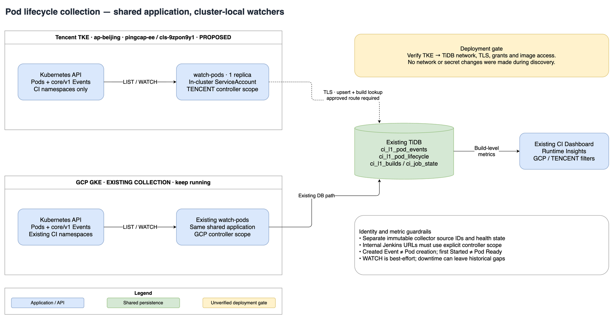

# Tencent TKE Pod Lifecycle Watcher

Status: consolidated design; NO CLS and shared GCP/TKE implementation approved.
Design review remains a gate; no implementation or deployment is claimed here.

Discovery date: 2026-10-23 (UTC).

## 1. Decision

Deploy the existing `ci-dashboard-jobs watch-pods` process **inside each TKE
cluster**, using its Kubernetes ServiceAccount to LIST/WATCH Pods and Events.
Write into the existing CI Dashboard pod tables and reuse Runtime Insights.
Use one shared jobs image and implementation in GKE/TKE. Do not add a Tencent
SDK, CLS, a Cloud API polling collector, a DaemonSet, or a second telemetry backend.

This phase changes design documents only. The later application PR includes the
collector, matching, reconciliation and renderer changes in §5/§8A, with no new
schema, historical key rewrite, production rollout, API or frontend changes.
Sequence: design DeepSeek review passes → implementation → code DeepSeek review
passes → PR for user review, **no merge**. This phase does not commit, push or
create that PR. External deployment/scheduling approvals are separate (§8B).

The watch transport is already cloud-neutral. Build attribution is not: fix its
GCP assumptions before production writes. A configuration-only deployment is
**not** sufficient.

First delivery means parity with the existing GCP event-based metrics, with
explicit coverage and accuracy limits. Exact per-container image-pull attempts
and creation-to-Pod-Ready timing are a separate extension, not names for the
current first-event metrics.



Editable source: [Draw.io diagram](images/tencent-pod-watcher.drawio).

Cost analysis: [initial cost estimate; CLS excluded](tencent-pod-watcher-cost-estimate.md).
The existing diagram remains accurate at this architectural level and is preserved.

## 2. Read-only findings

The existing discovery draft records the following reads using the `ai-agent`
tccli profile; this consolidation did not repeat or independently validate them:

`DescribeClusters`, `DescribeClusterEndpoints`, `DescribeClusterKubeconfig`, and
Kubernetes GET/LIST requests for version, namespaces, nodes, Pods, Events, and
Deployments. Bounded 10-second Pod and Event WATCH requests also completed; the
Pod stream returned a BOOKMARK. This validates API access, not an end-to-end
watcher rollout or the future ServiceAccount's RBAC.

The kubeconfig was held in a mode-0600 temporary file, removed afterwards.
No credentials were printed or committed; the default kubectl context was not
changed. No cluster resources were created, patched, deleted, or executed into.

| Item | Observation |
| --- | --- |
| Region | `ap-beijing` |
| Cluster | `pingcap-ee`, `cls-9zpon9y1`, running |
| Kubernetes | `v1.34.1-tke.6` API server |
| Network | VPC-CNI; native nodes plus an `eklet` virtual node |
| Node pools | Karpenter `ci-worker` and `ee-application` observed |
| CI namespaces | `prow-test-pods`, `jenkins-agents`, `jenkins-pd`, `jenkins-ticdc`, `jenkins-tidb`, `jenkins-tiflash`, `jenkins-tiflow`, `jenkins-tikv` exist |
| Active Jenkins samples | `jenkins-tiflash` and `jenkins-tiflow`; several other CI namespaces were empty during inspection |
| Standard Events | `Scheduled`, `Pulling`, `Pulled`, `Created`, `Started`, `FailedScheduling` |
| Additional Events | `FailedMount`, `FailedAttachVolume`, `SuccessfulAttachVolume`, `SuccessfulOccupyENI`, `SuccessfulOccupyENIIP`, `SucceedSetPodIP`, `FailedSchedulingOnEkletNodes`, `Nominated` |
| Jenkins metadata | `buildUrl` is an internal `jenkins.jenkins.svc.cluster.local:8080` URL; `runUrl` is relative; `jenkins/label` exists; `ci_job`/repo labels are not universal |
| Event timestamps | Scheduler Events use `eventTime`/sometimes `series`; kubelet Events also use `firstTimestamp`/`lastTimestamp`/`count` |
| Image caching | One bounded TiFlow sample contained 32 `Pulled` objects, 25 saying "already present on machine"; this is not a cluster-wide cache-hit rate |

Events were sampled with a 500-object page limit per inspected active namespace;
TiFlow had more pages. These are format/feasibility findings, not a complete
inventory or an incident diagnosis. Existing completed Prow Pods had no retained
Events in the inspected window, illustrating why a live watcher is needed.

`ap-hongkong`, `na-siliconvalley`, `ap-guangzhou`, and `ap-shanghai` returned no
standard TKE clusters for this profile. Other regions/accounts and separate
serverless cluster APIs were not exhaustively searched.

## 3. Architecture and boundaries

One watcher per cluster, one replica initially:

1. LIST each configured namespace's Pods and core/v1 Events, including pagination.
2. Persist Pod UID, true creation time, labels/annotations, and abnormal status.
3. WATCH from each collection's LIST `resourceVersion`; process Pod
   ADDED/MODIFIED/DELETED and Event ADDED/MODIFIED.
4. Normalize and upsert raw selected Events, then update lifecycle rollups and
   Jenkins/Prow linkage in the existing database transactions.
5. Reuse the existing Runtime Insights build-level queries and cloud filters.

Use in-cluster `https://kubernetes.default.svc`/service environment, mounted CA,
and projected ServiceAccount token. The runtime needs **no tccli credentials,
Tencent SecretId/SecretKey, GCP IAM, or remotely exported admin kubeconfig**.
The public API endpoint used for discovery is not a runtime dependency.

Reuse these tables:

- `ci_l1_pod_events`: selected Kubernetes Event observations.
- `ci_l1_pod_lifecycle`: one Pod identity, metadata and stage milestones.
- `ci_job_state`: operational status; isolate new Tencent source keys while
  preserving the existing GCP monitor key (§5.2).
- `ci_l1_builds`: read-only build facts for attribution.

### Database connectivity is a deployment gate

The current watcher writes synchronously to TiDB and reads build metadata.
Before rollout, verify connectivity **from TKE**, DNS, authenticated TLS with
certificate/hostname verification, DB grants, firewall allowlisting, and write
latency at expected volume. Neither database access nor GHCR/image-mirror access
from a new watcher Pod was tested in this discovery.

Prefer existing private connectivity; otherwise use an approved TLS endpoint
with narrowly allowlisted fixed egress. Do not expose the DB broadly or reuse an
unrestricted production administrator account. If no acceptable direct DB path
exists, revisit a durable Tencent-side event outbox plus central ingestion as a
separate design. Do not add Kafka merely because the collector is cross-cloud.

## 4. Metrics and honest semantics

| Metric | Definition | First delivery |
| --- | --- | --- |
| Pod creation instant | `metadata.creationTimestamp` | Store as `pod_created_at` |
| Scheduling wait | `scheduled_at - pod_created_at` | Reuse; `scheduled_at` comes from `Scheduled` Event |
| First-container preparation | `first_started_at - pod_created_at` | Derivable from existing fields; not whole-Pod readiness |
| Post-scheduling first start | `first_started_at - scheduled_at` | Existing `schedule_to_started_seconds` |
| Legacy image-pull proxy | `first_pulled_at - first_pulling_at` | Existing Runtime Insights metric; compatibility only |
| Full Pod startup | first observed Ready=True transition minus Pod creation | Follow-up: new persisted Ready milestone required |
| Exact image-pull duration | matched Pulling→Pulled for the same container/image/attempt | Follow-up: structured container/attempt evidence required |

Only compute durations when both endpoints exist and end >= start. Missing,
negative, or ambiguous evidence stays NULL/unknown, never a fabricated zero.
`Created` means **container** creation, not Pod creation. Scheduling wait includes
capacity/autoscaling delay and scheduling retries; it is not scheduler CPU time.

### Important limitations inherited from GCP

- Current rollups independently take MIN for each Event reason across the Pod.
  With multiple containers/init containers, the first Pulled may be a cache hit
  for a different container than the first Pulling. A nonnegative result is not
  sufficient proof of a correctly paired pull. Do not call this exact download
  time, sum it into an exact startup decomposition, or derive a cache-hit rate
  from absent Pulling Events.
- `first_started_at` can describe `jnlp`, a sidecar, or an init container. It does
  not prove the test runner, Jenkins agent connection, or all containers ready.
- Pod status conditions and node/pool information are not currently persisted as
  general timeline fields. Adding them requires explicit model/schema work.
- `FailedScheduling` is retry/pressure evidence, not by itself a terminal build
  failure. Likewise mount/attach and virtual-node warnings can later recover.
- Kubernetes Events are best-effort, aggregated, rate-limited, and retained only
  temporarily. Watch API support does not promise lossless lifecycle history.

Current Runtime Insights shows averages, not p50/p90. Its image-pull summary
currently turns missing averages/rates into zero, and its failure flag is an
incomplete-pull + completed-failure-build heuristic, not strictly an
ErrImagePull/ImagePullBackOff Event count. The empty-pull summary/N/A wording and
explanatory-label fixes are explicitly **deferred UI work**, not requirements of
collector parity. Until corrected, do
not use that summary as a strict registry-success SLI.

Canary validation must report valid sample counts, linked-build coverage,
collection start time and gaps using operational SQL/log/probe evidence, not a
new dashboard/telemetry backend. Compare matching jobs/branches and execution
modes, not an unqualified GCP-versus-Tencent population average. Keep the existing
build-level slowest-linked-Pod aggregation, not raw Pod weighting.

### Optional accuracy extension

If full readiness or accurate pull analysis is needed, extend the **shared**
GCP/TKE implementation, rather than introducing a TKE-only metric definition:

- Persist first observed `PodScheduled=True`, `ContainersReady=True`, and
  `Ready=True` transition times with provenance. Treat PodScheduled as a labelled
  fallback when Scheduled Event is missing, not a silent source substitution.
- Merge first-ready timestamps monotonically. A later Ready=False/completed Pod
  must not erase a previously observed Ready=True. Startup relist of an already
  completed Pod cannot recover a lost prior Ready transition.
- Preserve Event UID, first/last observed occurrence time, count/series,
  `involvedObject.fieldPath`, and container/image identity. Pair pull attempts
  conservatively, distinguish cache hits from timed pulls, and leave ambiguous
  attempts unknown. Do not sum parallel pull durations into wall-clock startup.
- Add node name and a minimal node metadata lookup only when pool/virtual-node
  segmentation is enabled; it needs additional node-read RBAC. An eklet path
  must be validated separately, not assumed equivalent to native kubelet Events.

These extensions, first-ready/new metric APIs or UI, cluster/node filters and
exact container-pull analysis are **outside this PR**. No schema migration is
included. Durable outbox and normal-watch-timeout relist optimization are also
follow-ups, not parity prerequisites.

## 5. Required changes before TKE production writes

### 5.1 Scope build attribution by source cloud/controller

A reproduced example in current code:

```text
Observed in TKE:
http://jenkins.jenkins.svc.cluster.local:8080/jenkins/job/.../159/

Current normalization:
https://prow.tidb.net/jenkins/job/.../159/  # GCP, incorrect for this controller

Expected for this TKE controller:
https://do.pingcap.net/jenkins/job/.../159/
```

Furthermore, `_normalize_jenkins_runtime_url` currently accepts only the GCP
Jenkins public prefix. Merely fixing `normalize_build_url` is insufficient.

Add `CI_DASHBOARD_POD_WATCH_CLOUD_PHASE=GCP|TENCENT` (unset defaults to `GCP`).
Resolve source from `CI_DASHBOARD_POD_WATCH_SOURCE_PROJECT`, falling back to
`CI_DASHBOARD_GCP_PROJECT` only for GCP compatibility. Before any DB writes or
worker startup, reject unknown cloud values, missing/blank sources, malformed
`tencent:<region>:<cluster-id>` IDs, and source/cloud disagreement: `TENCENT`
requires a `tencent:` source; a `tencent:` source is invalid with `GCP`, including
the unset/default case. Non-`tencent:` source IDs retain legacy GCP meaning.
For TKE, require existing cluster/location variables and agreement between the
source region and configured location. Do not infer controller/cloud from
cluster names or namespaces.

The validated context selects the expected Jenkins controller:
`GCP → https://prow.tidb.net`, `TENCENT → https://do.pingcap.net`. Use a small shared
context/helper, not per-cloud clients or a generalized factory. Propagate it through:

- internal and relative `buildUrl`/`runUrl` normalization;
- label + `ci_job` URL reconstruction;
- build-candidate queries, Prow pod-name lookup, and Jenkins pod-prefix cache;
- later lifecycle reconciliation, which must derive scope from each row's
  collector source rather than the reconciler process's default cloud.

Preserve explicit recognized public controller identity; do not rewrite an
explicit GCP URL to Tencent just because the Pod ran on TKE. With the current
single-controller deployment policy, reject/quarantine cross-scope candidates.
GCP backward compatibility covers existing environment variables/defaults, job
name (§5.2), source/row identities and recognized canonical URL hosts; it does
**not** promise unchanged attribution outcomes. The tightened matching rules below
apply to GCP as well as Tencent, including rejection of unknown absolute hosts,
contradictions/ties and the new ±24-hour build guard. Today unknown hosts with a
Jenkins path can normalize to GCP, and candidates are ranked by nearest start
within a 30-day lookback without that absolute guard. Removing these unsafe
matches can reduce GCP linkage coverage; measure and review the before/after
change in §8B, not a GCP-only bypass. Do not infer cloud from the
`jenkins.jenkins.svc.cluster.local` hostname, which is identical in both clusters.
Collector cloud and build-controller identity are separate concepts: the proposed
TENCENT context assumes the observed TKE controller; cross-cloud worker placement
would need an explicit controller mapping rather than a different cloud guess.

Matching contract for watcher, GCP sync and all reconciliation callers:

- Preserve recognized public hosts in full canonical URLs (including job-prefix
  keys); never strip hosts to compare paths. Internal/relative Jenkins URLs and
  label + `ci_job` reconstruction use the expected controller. Unrecognized
  absolute metadata hosts are rejected, not treated as relative/internal URLs or
  bypassed with weaker fallback.
- Evaluate `buildUrl` and `runUrl` together. A public URL contradicting scope,
  conflicting normalized metadata URLs, or conflicting candidate build identities
  blocks attribution; do not silently try a weaker prefix/label fallback. Missing
  evidence permits fallback; contradictory evidence does not. No arbitrary
  first/latest/lexicographic winner. Report the reason without secret/raw metadata
  dumps; leave new links unset and existing contradictory links unchanged for
  controlled repair, with no further build-derived enrichment.
- Apply expected `cloud_phase`, build system and controller-qualified URL guards
  to **every** metadata/label/candidate query, both the latest-per-job subquery
  and its outer join, and the Prow pod-name direct fallback. A Tencent build row
  whose key looks GCP is inconsistent evidence, not a match to be rewritten.
- Cache prefix maps by cloud/controller and reference window, never in a global
  mixed-cloud map. Scope **before** latest-per-job selection so one cloud cannot
  hide the other's samples. Retain count/recency ranking only for a unique best
  prefix mapping; ties between distinct job URLs are ambiguous, not resolved by
  URL ordering. Conflicting stronger evidence invalidates prefix fallback.
- Use `scheduled_at`, else true `pod_created_at`, as the Pod reference time. The
  existing 30-day prefix-history lookup is discovery, not attribution proof.
  Proposed conservative build guard: `start_time` within ±24 hours of that
  reference (an explicit assumption to check in canary samples). Missing time
  disallows time-based fallback/enrichment; never pick the newest build globally.
  A single consistent metadata URL may be retained pending build arrival, but
  does not alone establish a build-row link. Prow uses its own exact ID where
  available; pod-name fallback requires one distinct in-scope Prow build within
  the same time guard, not job-name equality or newest-name wins.
- Cross-source reconciliation derives context **per row**: `tencent:` means
  TENCENT, legacy non-`tencent:` sources mean GCP. Validate Tencent IDs, group
  queries/caches by that scope, and reject malformed/contradictory rows. Never
  inherit the reconciler process's cloud default for stored rows. GCP Logging
  recent reconciliation selects GCP sources only; explicit DB-only Tencent
  reconciliation must not call Logging or the local cluster for metadata.

Migration `031_classify_tencent_builds.sql` notes legacy Tencent correlation keys
may already contain GCP-canonicalized URLs. Audit actual target build keys before
rollout. Do not bulk-rewrite historical URLs or reclassify build cloud from URL
alone without original-controller evidence. A required key repair is a separate,
bounded and reviewed data migration.

### 5.2 Isolate source identity and operational state

Suggested immutable source ID:

```text
source_project = tencent:ap-beijing:cls-9zpon9y1
cluster_name   = pingcap-ee
location       = ap-beijing
```

`source_project` is a legacy column name; use it as a collector identity for TKE,
not Tencent's numeric `ProjectId` (the observed value is 0). Agree on any account
component before rollout if multiple Tencent accounts will share the DB.

Keep existing identities:

- lifecycle: `(source_project, namespace_name, pod_uid, pod_name)`;
- Event observation: `(source_project, source_insert_id)`, currently using Event
  UID/resourceVersion for watch ingestion.

Do not use `TENCENT` alone as source ID, and do not change existing GCP identities.
Existing GCP watchers keep the job name `ci-watch-pods`, including existing
explicit-source configurations, so current monitors do not silently lose their
signal. New Tencent collectors use `ci-watch-pods:<source-id>` for every
start/success/failure update, never the legacy row. Validate that this full key
fits the existing `ci_job_state.job_name VARCHAR(64)` (Tencent source at most 50
characters); reject overlong configuration rather than truncate or add schema.
The example fits. Source IDs must also fit the pod tables' 128-character limit.
New scoped GCP job names would require a separate explicit monitor migration,
not an implicit rename here.

The status API already enumerates all job rows; verify ops consumers/alerts
recognize the Tencent names rather than requiring an API rewrite. Healthy GCP
collection must not mask failed TKE collection.

### 5.3 Refresh projected ServiceAccount tokens

`_KubernetesClient` currently receives the token once at process start. Read the
projected token file afresh for every LIST page/request and WATCH connection,
including reconnects; do not retain an open file descriptor across atomic token
replacement. Keep credentials request-local so parallel streams cannot overwrite
a shared token. Missing/empty/unreadable files fail the request without sending
an empty bearer token or falling back to admin/cloud credentials.

On HTTP 401, or a WATCH ERROR Status with code 401, reread the file and allow
**one** authentication retry for that request/connection. A second 401 returns to
the existing bounded-delay worker retry/health path, not a tight refresh loop;
403 is an authorization error, not a token-refresh trigger. Preserve TLS/CA
verification, pagination continuation and processed resourceVersion semantics.
Never log bearer tokens or headers. Test shared-client rotation and persistent
401 explicitly; do not substitute long-lived manually created tokens.

### 5.4 Preserve TKE diagnosis evidence

Keep `POD_EVENT_REASONS` as the existing common baseline. In the shared
implementation, add these diagnostic reasons **only for validated TENCENT
contexts**: `FailedMount`, `FailedAttachVolume`, `SuccessfulAttachVolume`,
`SuccessfulOccupyENI`, `SuccessfulOccupyENIIP`, `SucceedSetPodIP`,
`FailedSchedulingOnEkletNodes`, `Nominated`. GCP watch and the GCP Logging filter
retain the baseline allowlist; do not extend the constant used by Logging with
Tencent additions. Store the added reasons in the existing raw Event table;
do not redefine abnormal/terminal-build summaries from these warnings. The cost
estimate's 40 versions/Pod assumption excludes these additional reasons and
requires canary measurement.

Normalize Event time evidence in the existing columns, in UTC, in both the API
normalizer and GCP Logging payload normalizer:

- Preserve `event_timestamp`'s current transport-specific precedence for new
  rows: API `eventTime → lastTimestamp → firstTimestamp → metadata.creationTimestamp`;
  Logging envelope `timestamp → payload.lastTimestamp`. A kubelet Event with
  both legacy timestamps therefore still indexes at its last time, not its
  first. This column remains the legacy observation/query time axis, not a
  uniformly first-occurrence column. Historical values are not rewritten, and
  replay of an existing observation must not change this precedence.
- Populate `first_timestamp` from `eventTime`, else `firstTimestamp`, else the
  Event object's `metadata.creationTimestamp` as a lower-fidelity proxy. If none
  exists, leave it NULL; a last-only or Logging-envelope-only time is not new
  first-occurrence evidence. `eventTime` is the first observation, not each
  series recurrence. Never use receipt time as occurrence time.
- Populate `last_timestamp` with the maximum valid `series.lastObservedTime`,
  `lastTimestamp` and the first-occurrence evidence above; leave it NULL if all
  are absent. Earlier last times cannot regress first-occurrence evidence.

Use these exact NULL-safe scalar expressions in both lifecycle aggregate paths
(`events.` qualifiers omitted here):

```sql
-- stage_time: retain timestamp-only compatibility proxies, exclude last-only rows
COALESCE(first_timestamp,
         CASE WHEN last_timestamp IS NULL THEN event_timestamp END)
-- latest_time: preserve the legacy time axis if it is later than the payload
CASE WHEN last_timestamp > event_timestamp
     THEN last_timestamp ELSE event_timestamp END
```

For each stage reason (`Scheduled`, `Pulling`, `Pulled`, `Created`, `Started`),
use `MIN(CASE WHEN event_reason = '<reason>' THEN stage_time END)` with the scalar
expression substituted, not a literal `MIN(first_timestamp)` that drops legacy
NULLs. Use `MAX(CASE WHEN event_reason = 'FailedScheduling' THEN latest_time END)`
and `MAX(latest_time)` for `last_failed_scheduling_at` and `last_event_at`;
abnormal-summary recency uses the same latest expression. Keep existing API
query/window filters on `event_timestamp`; it is not replaced by first/latest.

Timestamp-only rows, old or new, retain `event_timestamp` as an explicit
compatibility proxy, not a proven first occurrence. This includes Logging-envelope-only
rows; no new provenance field is added. Rows with NULL first but an explicit last
are excluded from first-stage MINs: they cannot recover a first time from that row.
Merge rollups with stored lifecycle MIN/MAX extrema: preserve already stored
first milestones/latest failures even when raw evidence is absent or skipped.
No raw-row backfill or dedicated historical lifecycle repair is included.

Event replay, series updates and relists must not move an established first
milestone later or a latest failure earlier. Merge with stored lifecycle extrema
so raw retention does not erase known milestones; no historical raw-row rewrite.
Current raw rows are Event observation **versions**, not independent attempts.
`failed_scheduling_count` remains a legacy stored-version count, not an occurrence
or failure-attempt SLI; do not sum relists, resourceVersions or `series.count` as
unique failures. Exact occurrence counts require a separate Event-UID/series
model and are outside parity scope.

### 5.5 Neutral deployment configuration

The runtime already accepts `CI_DASHBOARD_POD_WATCH_SOURCE_PROJECT`; the renderer
still requires `--gcp-project`. Add `--source-project` and `--cloud-phase` (default
`GCP`); retain `--gcp-project` as a GCP compatibility alias. Equal aliases are
allowed, conflicting values fail; `--gcp-project` cannot supply a Tencent source.
Render the generic source env, explicit cloud context and existing
`--cluster-name`/`--location` variables. Old GCP-only invocations retain equivalent
GCP source/context and the legacy GCP env; generic Tencent invocations do not put
TKE identity into `CI_DASHBOARD_GCP_PROJECT`. Apply the same source/cloud validation
as runtime, quote YAML scalar values, and reject invalid input before rendering.
Use `replicas: 1` and `strategy: Recreate`; reject replica counts other than one
until an explicitly designed leader-election mode exists.

### 5.6 Delayed attribution and authoritative metadata preservation

The watcher retries linkage on Pod/Event updates but has no periodic linkage
loop. A Pod can disappear before its build fact arrives. **Extend the existing**
`reconcile-pod-linkage-range` CLI and
`run_reconcile_pod_linkage_for_time_window` helper in `sync_pods.py`; do not create
a duplicate command or a new collector loop. The command is DB-only: read saved
Pod metadata and build facts, never call GCP Logging or Kubernetes.

Selection/progress contract:

- Add `--source-project` as an exact SQL filter for routine delayed-linkage runs.
  Legacy invocations without it retain cross-source range operation but must use
  per-row scope (§5.1), not a single unscoped prefix map. The GCP sync caller is
  restricted to GCP sources. New scheduled Tencent runs always pass a source.
- Select incomplete linkage/enrichment rows using
  `COALESCE(scheduled_at, pod_created_at)` in a fixed `[from, to)` UTC window,
  including metadata-only and unscheduled Pods with real creation time. Rows
  lacking both are skipped/reported, never selected by `updated_at`/receipt time.
  Read `pod_created_at` in the selection, not just metadata deserialization.
- Preserve inclusive CLI date semantics (`--end-date` becomes next UTC midnight).
  If omitted, resolve it to the invocation's current UTC date, not an unbounded
  query; report that date so resume can pass it explicitly with identical bounds.
  Reject inverted/empty ranges. Routine scheduling uses the existing 72-hour
  recent-window policy (three UTC dates for the date CLI); older arrivals require
  explicit small repair windows.
- Freeze a source/window maximum lifecycle ID at run start. Scan ordered IDs
  `after_id < id <= through_id`, advancing after **every selected row**, including
  unmatchable/ambiguous rows. CLI batch size defaults to 1,000 and is capped at 1,000;
  add `--max-rows` (default/cap 10,000) to bound selected/scanned rows, not only
  updates. Validate positive limits; each batch selects at most
  `min(batch_size, max_rows - scanned)`. No new watermark table.
- Add `--after-id` and `--through-id` for explicit resume; report both plus source,
  frozen time bounds and scanned/updated/ambiguous/skipped counts. Resume with
  identical bounds/ceiling only after the preceding batch committed. Failed
  batches can replay idempotently. A completed sweep's next scheduled run starts
  at ID zero over an overlapping recent window so late builds/earlier skipped
  rows are retried; a forward-only permanent cursor would lose delayed matches.

Transaction ownership is explicit:

- `run_reconcile_pod_linkage_for_time_window` takes an **Engine**. Extend that
  existing CLI entry point to freeze the ceiling in a short read transaction,
  then own one `engine.begin()` per batch, committing before publishing its
  resume cursor/counts. Earlier batches remain committed if a later one fails;
  report only the last committed cursor for resume.
- `_reconcile_lifecycle_rows_in_time_window` takes a **Connection**. Reuse its
  connection-only batch body; it must never commit/rollback the connection or
  open independent transactions. The Engine entry point drives per-batch
  transactions; `_reconcile_recent_lifecycle_rows` in GCP `run_sync_pods` keeps
  its existing single caller-owned `engine.begin()` across its bounded loop.
  Freeze that caller's upper time bound at invocation time as well. GCP keeps
  `settings.jobs.batch_size` as its fetch-page size, not a commit boundary; CLI
  `--batch-size`/`--max-rows` limits do not apply to that caller. It completes the
  frozen GCP recent-window sweep without a partial-resume cursor, as today.
  A GCP failure rolls back that whole reconciliation transaction; no batch
  cursor is durable before caller commit.

Both paths stop at the frozen ceiling/window; the CLI additionally stops at its
scan cap even if zero links are updated. Tests must distinguish CLI partial
commits from GCP caller rollback.

Only fill missing linkage/enrichment from a unique, consistent match. Do not
rebind a populated conflicting URL/Prow ID, or pair an old URL with a new build's
fields; report it for controlled repair. Unresolved candidates remain unchanged.
Condition updates on exact source/ID and unchanged previously read linkage values;
if a concurrent watcher filled or changed the link, skip/re-read rather than
blindly overwrite it. Scheduling/cadence, DB query-plan/load review and single-run ownership are
**reviewed ee-ops rollout actions** (§8B), not a new CronJob deployed by this PR.

The GCP `sync-pods` path can currently upsert NULL creation time/labels after Pod
deletion. In both sync and watcher Event-only paths, merge the stored snapshot
for the exact source/namespace/UID/name when no live snapshot exists. Preserve
true creation time, labels/annotations, metadata observation time and derived
Pod fields; an absent snapshot is not an authoritative empty one. A real newer
Pod snapshot may intentionally have empty labels/annotations; distinguish that
case and accept it. A missing creation timestamp must never erase a known one,
and an Event `Created` must never manufacture Pod creation. Keep abnormal
summaries/milestones when absent from the incoming observation. Reconciliation
updates only missing linkage and supplemental build-derived fields, never raw
Pod metadata or timestamps. Enforce snapshot preservation/observation ordering
and milestone extrema in the shared DB upsert too, not just a pre-read merge,
because Pod/Event writers can race. Test SQLite execution and MySQL/TiDB SQL
semantics.

## 6. TKE deployment proposal

Deploy through the existing `ee-ops` GitOps ownership, not an ad hoc local
`kubectl apply`. This repository supplies application behavior/rendering; the TKE
Deployment/RBAC/secret references belong in the ops repository.

Suggested deployment settings (proposed, not an executable existing manifest):

```yaml
namespace: ee-cd
name: ci-dashboard-pod-watcher-tencent
serviceAccountName: ci-dashboard-pod-watcher
replicas: 1
strategy: Recreate
image: <verified release of ci-dashboard-jobs, pinned by digest>
env:
  CI_DASHBOARD_POD_WATCH_SOURCE_PROJECT: tencent:ap-beijing:cls-9zpon9y1
  CI_DASHBOARD_POD_WATCH_CLOUD_PHASE: TENCENT # proposed setting
  CI_DASHBOARD_KUBERNETES_CLUSTER_NAME: pingcap-ee
  CI_DASHBOARD_KUBERNETES_LOCATION: ap-beijing
  CI_DASHBOARD_POD_EVENT_NAMESPACES: prow-test-pods,jenkins-agents,jenkins-pd,jenkins-ticdc,jenkins-tidb,jenkins-tiflash,jenkins-tiflow,jenkins-tikv
  CI_DASHBOARD_POD_WATCH_TIMEOUT_SECONDS: "300"
  CI_DASHBOARD_POD_WATCH_RETRY_DELAY_SECONDS: "5"
  CI_DASHBOARD_POD_WATCH_STALE_AFTER_SECONDS: "720"
  CI_DASHBOARD_POD_WATCH_HEALTH_PORT: "8081"
```

`ee-cd` exists; final namespace placement needs the ops owner's confirmation.
Watch all listed existing CI namespaces, even if empty at inspection time.
Exclude the `jenkins` controller namespace by default to avoid mixing controller
maintenance Pods into CI-worker statistics.

- Dedicated SA; namespace-scoped RoleBindings granting only get/list/watch on
  Pods and core/v1 Events (a shared ClusterRole is acceptable only with these
  namespace bindings, no ClusterRoleBinding). Remove unused PVC reads from the
  watcher RBAC renderer: this watch path does not query PVCs. GCP `sync-pods` PVC
  mapping is separate and its permissions are not removed here. No Secret,
  exec/log, write, node-read, or cluster-admin grants.
- Run on stable `ee-application` native capacity, not a CI-worker drain target or
  an eklet virtual node. Select that pool via verified scheduling constraints;
  avoid new speculative scheduling policy.
- Start from existing requests 500m/1Gi, limits 1 CPU/2Gi; right-size from measured
  write rate, reconnect/relist cost, and memory after the canary.
- Reuse startup/liveness/readiness probes on port 8081. There are two health
  streams per namespace; idle namespaces must remain healthy through successful
  LIST/WATCH turnover, even without CI Events.
- Pin the image and verify pullability from TKE; an existing approved mirror can
  be used without changing image content. Do not assume access to GHCR.
- Use dedicated DB credentials in the existing secret-management flow: SELECT on
  required owned pod/build tables and INSERT/UPDATE on pod tables and the scoped
  job-state row/table. No permissions on upstream source tables or schema DDL.
- Allow only necessary egress: DNS, Kubernetes API and approved DB; image pulls
  also require node/runtime registry connectivity. No inbound public Service.
- Do not enable GCP Cloud Logging `sync-pods` in TKE. It is a separate GCP-only
  history/reconciliation path and is not an automatic Tencent fallback.

## 7. Reliability, gaps, and monitoring

Reuse reconnect, watch timeout, immediate relist on HTTP/WATCH ERROR 410 Gone,
idempotent upserts and transaction retries. An expired pagination continuation
also restarts LIST rather than mixing collection snapshots. Preserve successful
LIST/WATCH heartbeats for empty namespaces. Normal watch-timeout relisting stays
as-is; resuming without relist on normal turnover is a separate optimization.
One replica with Recreate avoids duplicate active writers during rollout; it
does not provide zero downtime. Multiple replicas
without leader election double collection work and do not make Events durable.

A watcher restart can recover current Pod metadata and still-retained Events.
It cannot recover a Pod created and deleted during downtime after its Events
expire, or a Ready transition never observed. A durable resourceVersion
checkpoint alone cannot fix expired history.

Monitor per source/namespace:

- stream heartbeat age and readiness, restarts/relist/401/403/410 counts;
- last successful persistence and DB error/latency, separate from stream health;
- creation-time coverage, valid scheduling/pull samples, attribution coverage;
- ingestion delay from receive/persist time versus occurrence time, separating
  old startup-relist Events from genuinely delayed live Events.

Suggested live-ingestion target: p95 < 60s for normal live Events. Treat it as a
proposed SLO to measure, not a guarantee proven by discovery. A quiet namespace's
lack of recent Events is not an outage; failed heartbeat/persistence is.
Current long-running job state is not a periodic success heartbeat, so
`last_succeeded_at` alone is not a watcher availability signal.

Without a durable outbox, sustained DB/network failure can produce collection
gaps. Alert and expose the interval rather than claiming exactly-once capture.
Retain existing table retention policy; confirm it operationally before rollout.
No separate Tencent retention policy or unbounded raw JSON archive is introduced.

## 8. Implementation and acceptance

### A. Application preparation

| Area | Relevant files | Change |
| --- | --- | --- |
| Collector context/auth/state | `src/ci_dashboard/jobs/pod_watcher.py` | Cloud/source context, token refresh, scoped job state |
| Matching/reconciliation/events | `src/ci_dashboard/jobs/sync_pods.py`, `src/ci_dashboard/jobs/build_url_matcher.py`, `src/ci_dashboard/jobs/cli.py` | Scope every fallback; extend existing `reconcile-pod-linkage-range`/helper; preserve snapshots; TKE reasons/timestamps |
| Deployment | `scripts/render_pod_watcher_deployment.sh`, `scripts/render_pod_watcher_rbac.sh` | Neutral source flag, explicit context, singleton strategy and minimal permissions |
| Read APIs/UI | Existing Runtime Insights | Regression verification only; no API/frontend or new metric changes required |
| Tests | `tests/jobs/test_pod_watcher.py`, `test_sync_pods.py`, `test_build_url_matcher.py`, `test_cli.py`; new `tests/test_pod_watcher_renderers.py` | Offline dual-cloud SQLite fixtures, renderer text fixtures and failure/restart/compatibility coverage |

No new tables are needed for the parity delivery. Verify live schema supports
current migrations, particularly Pod creation time and abnormal-summary fields;
repository DDL is not proof of production DB shape. Ready/container extensions
would need a separate additive migration and API changes.

Required automated regression cases:

1. Identical internal Jenkins host, job path and build number in both clouds:
   unique in-scope candidates within the time guard retain expected GCP links
   and link Tencent only to its expected controller/cloud. Separately assert
   both clouds reject formerly accepted unknown hosts and out-of-guard matches;
   GCP compatibility is limited as defined in §5.1.
2. Both public hosts, internal/relative metadata, labels, same pod-prefix/build
   number and Prow direct fallback in both clouds; unknown/public-host conflicts,
   buildUrl/runUrl contradictions, prefix ties and populated-link contradictions
   stay unlinked/unchanged. Delayed reconciliation is source-scoped even when a
   cross-source CLI is invoked with a GCP process default; GCP sync skips Tencent.
   Legacy Tencent GCP-looking build keys are rejected, not silently repaired.
3. Same Pod name in different source IDs, Event replay/modified versions, Event
   arriving before Pod snapshot, and DELETED final snapshot remain idempotent.
4. `eventTime`/legacy timestamps/series preserve the legacy `event_timestamp`
   precedence while first/latest rollups use §5.4 expressions; cover NULL legacy
   firsts, timestamp-only/last-only rows, later Logging envelope times and stored
   extrema after retention. ENI/mount reasons are accepted only for Tencent;
   GCP watch/Logging reason sets stay unchanged. Cache hits/multiple containers
   do not invent exact pull duration/counts.
5. Atomic token-file rotation between LIST pages/reconnects, one-retry 401
   recovery and persistent-401 bound, 403, HTTP/stream 410, pagination expiry,
   empty namespace, disconnect and DB recovery; independent Tencent state with
   unchanged GCP job name. Invalid source/cloud/overlong-state-key cases fail
   before writes.
6. GCP Logging and Event-only updates cannot erase watcher snapshots after Pod
   deletion; a real empty live snapshot is distinguishable. Delayed builds link
   deleted/metadata-only unscheduled Pods via creation time; rows with no time,
   UTC boundaries, ID gaps, batch caps, ambiguity, crash/replay, same-bound resume
   and overlapping next-sweep retries obey §5.6 without snapshot changes. Check
   CLI per-batch commit/resume versus GCP caller-owned rollback, CLI scan caps
   even with no updates, and no inner commit of a caller's Connection.
7. Renderer old `--gcp-project` invocation and generic GCP/Tencent forms, equal
   versus conflicting aliases, explicit context/cluster/location, YAML scalar
   quoting, singleton Recreate and namespace-only Pod/Event RBAC.

Implementation verification plan (not executed by this design-only phase):

```bash
cd ci-dashboard
PYTHONPATH=src python3 -m pytest tests/jobs/test_pod_watcher.py tests/jobs/test_sync_pods.py tests/jobs/test_build_url_matcher.py tests/jobs/test_cli.py tests/test_pod_watcher_renderers.py --cov=ci_dashboard.jobs.pod_watcher --cov=ci_dashboard.jobs.sync_pods --cov=ci_dashboard.jobs.build_url_matcher --cov=ci_dashboard.jobs.cli --cov-report=term-missing --cov-fail-under=0
make test
make lint
make test-cov
bash -n scripts/render_pod_watcher_deployment.sh scripts/render_pod_watcher_rbac.sh
```

Add `tests/test_pod_watcher_renderers.py` using pytest and stdlib `subprocess` to
invoke both Bash renderers offline. Compare complete rendered text against
explicit expected YAML fixtures for legacy GCP and generic GCP/Tencent; assert
scalar escaping, source/context/cluster/location, singleton strategy and only
namespace-scoped Pod/Event grants. Check invalid/conflicting inputs fail with
nonzero exit and no manifest output. Use rendered-text assertions, not YAML
parsing: no YAML parser is currently declared and none is added for these tests.
Mock HTTP/token files; use SQLite build/pod fixtures, no cloud credentials or
live DB required. Report measured changed-module coverage separately from
`make test-cov`'s whole-project result (configured threshold 90%); targeted
percentages are not whole-project coverage. Review MySQL/TiDB SQL generation separately from SQLite execution.
For this phase, validate local Markdown links, whitespace and diagram XML;
coverage is not applicable to documentation-only edits.

### B. Rollout, after separate approval

1. Resolve DB network/TLS/grants and image availability; audit sampled Tencent
   build keys/controller identity; verify schema and dedicated SA permissions.
   Before upgrading either shared GCP writer, run old/new attribution read-only
   or offline on the **same frozen GCP source/time-window Pod/build snapshot**.
   Report matched/scanned counts and coverage before/after by namespace and
   metadata/label/prefix/Prow path, plus lost/new/changed links and rejection
   reasons (unknown hosts, contradictions/ties, ±24-hour guard). Manually review
   differences; no unexplained losses or cross-cloud links may pass. An accepted
   coverage reduction from the safety rules is recorded explicitly, not hidden
   by cloud-branching the rules. This is a rollout gate, not a measurement claimed
   in this design-only phase.
2. Ops owners review the DB-only reconciliation schedule/cadence (proposed hourly
   overlapping recent sweeps), exact source/time/row bounds, query plans/load,
   non-overlapping ownership and missed-run/lag alerts. No CronJob or ops resource
   is deployed by this PR. Render/review watcher manifests and alert-name support.
   Canary one active namespace (`jenkins-tiflow`),
   then add the full explicit namespace list after a successful observation
   window. Existing GCP collection remains running with compatible configuration,
   identities and monitor names; its attribution changes are reviewed in step 1.
3. Sample at least 100 newly observed Pods, or explicitly record insufficient
   activity, over a proposed 24-hour canary. Target >=99% creation-time coverage
   among observed Pods, zero known cross-cloud mislinks, and p95 live ingest
   delay <60s. Validate scheduling coverage only for Pods actually scheduled with
   retained/observed evidence, and report the denominator.
4. Manually match a sample of UID, creation time and Event timestamps against
   Kubernetes; verify newly completed Tencent builds appear under TENCENT and
   valid GCP comparison samples retain the expected controller identity. Evaluate
   attribution coverage per namespace, not a misleading single all-Pod success
   threshold.
5. Test watcher restart and token renewal; DB disconnect/recovery testing must be
   approved and isolated, never induced against unrelated production traffic.
6. Expand namespaces, publish collection start/coverage and known gaps. Empty or
   eklet execution paths remain explicitly unvalidated until exercised.

Rollback: revert/disable only the new TKE Deployment via GitOps; keep existing
GCP collection and collected TKE rows. Do not delete tables or re-key sources.
If attribution is wrong, stop the new writer and quarantine/repair that source's
bounded rows after review; reverting the image alone does not undo wrong links.

## 9. Open deployment gates

- Does this Beijing cluster cover the intended Tencent CI scope, including all
  required accounts/regions and native versus eklet execution?
- Is the approved TKE-to-TiDB route available, and are current Tencent build
  correlation keys consistent with `do.pingcap.net`?
- Confirm ops namespace, secret owner, alert owner and image mirror.
- Confirm reconciliation schedule/owner, bounded query cost and existing retention
  policy before enabling delayed-linkage runs.

First-Pod-Ready, new APIs/UI, cluster/node filters, exact pull/occurrence analysis,
empty-pull summary wording, durable outbox and normal-timeout relist optimization
are follow-ups, not open first-release scope choices. No production resources,
new schema or historical key repair is authorized by this document.

## 10. Source anchors

- [Existing watcher design](pod-watcher-design.md) (historical design; source
  takes precedence where it differs).
- [Runtime Insights](runtime-insights-design.md).
- `src/ci_dashboard/jobs/pod_watcher.py`: `_KubernetesClient`,
  `_normalize_pod_object`, `_normalize_kubernetes_event`, `_load_runtime_context`.
- `src/ci_dashboard/jobs/sync_pods.py`: lifecycle MIN rollups,
  `_load_build_metadata_map`, `_load_jenkins_pod_name_url_prefix_map`,
  `_normalize_jenkins_runtime_url`, `run_reconcile_pod_linkage_for_time_window`.
- `src/ci_dashboard/jobs/cli.py`: existing `reconcile-pod-linkage-range` parser
  and dispatch (extend these, do not add another command).
- `src/ci_dashboard/jobs/build_url_matcher.py`: internal-host/default GCP mapping.
- `sql/005_create_ci_l1_pod_events.sql`, `006_create_ci_l1_pod_lifecycle.sql`,
  `017_alter_ci_l1_pod_lifecycle_add_pod_created_at.sql`,
  `022_alter_ci_l1_pod_lifecycle_add_abnormal_summary.sql`,
  `027_drop_unused_pod_lifecycle_metadata_columns.sql`,
  `031_classify_tencent_builds.sql`.
