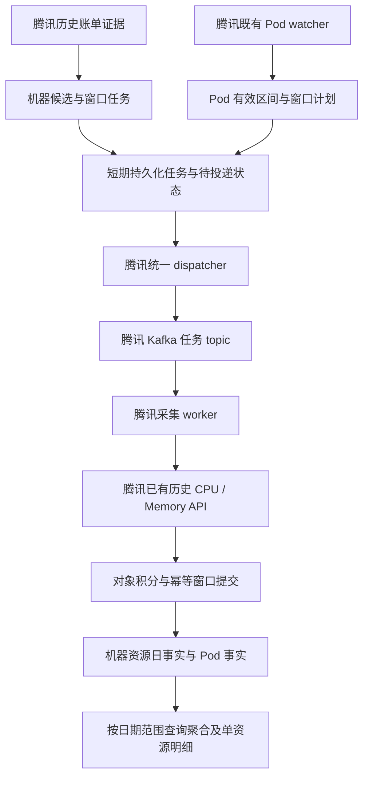

# 腾讯云资源利用率 V2：历史机器清单与异步窗口采集

> 设计历史：本文件保留 V2 审查依据；当前实现和部署边界以 [V3](resource-utilization-design-v3.md) 及[操作说明](resource-utilization-operations.md)为准。

状态：**V2 实现中，尚未部署；变更需独立 review 与回归通过后推送现有 PR**。讨论与只读验证日期：2026-11-25。
范围：仅腾讯 CICD 账号 `100050658403` 的 CPU / memory；不发现其他组织账号。

本文件总结本轮已确定的调整方向，并将实施协议中仍需细化的部分单列。与 V1 冲突的采集 / 调度条款以本修订方向为准，未修改的业务与生命周期约束仍沿用 V1。不是对现有代码能力的描述，也不代表已经通过 V2 实施评审。

**实施顺序：逐表业务讨论已完成，用户已授权按 V2 统一修改 SQL、代码、测试和静态部署方案；独立 PI DeepSeek change review 通过后普通 push 到现有 PR。没有授权合并、生产迁移、采集切换或上线。**

下文保留逐轮讨论轨迹；涉及“待确认 / 尚未实现”的历史审查，以 §16 的业务收口、§17 的当前实现和操作文档为准。

## 1. 与 V1 的关系

[V1 主设计](resource-utilization-design.md)对应当前实现基线；本文件修订其中的资源发现、调度、失败恢复和部署边界。尚未切换前，现有代码仍按 V1 运行且默认关闭。

| 项目 | V1 实现基线 | V2 修订方向 |
| --- | --- | --- |
| 机器发现 | 每 30 分钟枚举当前 CVM，保存观察证据；历史 Node 监控补充身份 | 从历史账单提取出现过的机器和规格，生成有界查询任务；不再以当前存活清单为主要历史发现手段 |
| Pod 发现 | watcher 提供元数据，但监控查询由 Node 监控返回的 ID 驱动 | watcher 提供 Pod 身份、历史 Node 查询键及有效区间，独立生成 Pod 窗口任务 |
| 机器调度 | 与 Pod 一起按天重读监控 | 已过去的历史窗口入队后立即可执行，不另设业务延时 |
| Pod 调度 | 每天四次重算当天 / 前一天 | 统一调度器扫描到期窗口；建议每 10 分钟补采一段历史分钟数据 |
| 恢复 | SDK 有限重试；失败后下次从日初重算，无持久化窗口断点 | 持久化任务与完成进度，按未完成窗口恢复；重复投递不重复累加 |
| 消息基础设施 | 利用率采集未使用 Kafka | 复用腾讯侧 Kafka，新增任务 topic、身份 / ACL 和 worker；不复用 Jenkins 业务 topic |
| 跨云 | 讨论中曾建议 GKE dispatcher 中转 | **撤销该建议**：腾讯采集只处理腾讯数据，使用腾讯侧 dispatcher / Kafka / worker，不桥接 GCP Kafka |

业务约束与本轮修订：

- 机器层评估实际使用量 / 机器容量；Pod / Job 层评估实际使用量 / requests。两层 scope 不能相加。
- **峰值仅针对单个实例**：单台 CVM / Node，以及计算中可得的单个 Pod 实例。稳定 Job、repo、规格组、账户分类的日 / 周报只看加权平均与覆盖率，不计算或保存组峰值、组子集峰值，也不把个体峰值的均值或最大值换名冒充组指标。
- 优化维度为 repo → 稳定 Job → 资源类别 / 规格；不增加个人利用率、磁盘 / PVC 利用率或自动缩容。
- 复用腾讯已有历史监控，不新增 Agent、Prometheus 或 Kubernetes 当前用量采样器。
- 机器使用按单资源 / 日保存**一年**，支持最近任意 N 天查询和单机器明细；取消固定账户分类周汇总表，周 / 月 / 最近 N 天查询时聚合。本阶段不建设复杂机器清理体系。Pod 上下文 / 实例工作数据只保留活跃采集所需部分及有界尾段处理，处理完清理；不归档原始分钟点、不建立长期逐 Pod 流水，见 §16。
- 既有账单、磁盘计费、个人分账不变；不把分摊费用伪装成精确 Job 成本。
- [V1 生命周期约束](resource-utilization-retention-design.md)中的独立维护、容量门禁和不可无限积压继续成立。机器日事实不再套用“两周删除、只留周汇总”；任务 / outbox / 中间工作集仍需固定到期与写入 fence，保存期和关闭协议按 §8、§14 重新区分。

## 2. 两条独立采集链路

机器和 Pod 是两个独立的采集 / 分析维度，不是没有对象关系：Pod 可以关联其历史 Node，但这种关联不是对机器利用率任务成功的依赖。

**事实必须分开**：机器事实只描述机器身份、历史容量 / 规格、用量与覆盖，不承载从 Pod 推来的 Job、repo、测试项目或 author。一台机器可以承载多个业务的 Pod，不能用其中一个 Pod 的标签标记整台机器。Pod 事实绑定自身 UID、requests 及当时可验证的业务标签；Job / repo / 测试项目是标签聚合方式，不是固定事实类型。author 缺失不影响采集，也不扩大既定的非个人利用率范围。若以后需要将机器成本与业务联系，须通过 Pod 关系及单独定义的归因 / 分摊规则，不能直接投影机器用量。



- 机器链路不要求先收齐 Pod 用量；Pod 链路不等待机器监控枚举完成。
- Node 身份映射缺失时标记 Pod 任务的查询证据缺口，不以机器链路返回空作为 Pod 不存在的证明。
- 腾讯与 GCP 各自的同名 `cluster-cd` 不是同一个 Kafka；不新增跨云 Kafka listener 或中转。
- 数据库 / 报表是否沿用现有共享设施是部署接入问题，不等于跨云指标采集。V2 不要求搬迁既有数据库，也不授权因此新增迁移；腾讯侧身份、网络及最小权限仍须核验。

## 3. 机器：从历史账单发现，入队直接采

### 3.1 候选来源与去重

优先复用已经导入、范围校验通过的腾讯历史账单证据，而不是每轮重下载全部文件，或仅轮询当前存活机器。

不再依赖当前存活清单发现历史机器，并不等于禁止 watcher 为 Pod 的 Node 查询键、身份 / allocatable 证据继续执行必要的 Node LIST；这种元数据采集不生成历史机器总体，也不能补造过去的容量。

1. 按明确的账户、地域、使用日期和计算资源产品读取已完成的账单范围。
2. 从原始资源 ID、地域 / cluster 和计费组件提取机器身份与历史规格。
3. 按规范资源身份及时间范围去重，生成对应指标契约的窗口任务；不能按 BillId / 组件行逐条创建相同监控请求。
4. 账单迟到或真实规格修订仅补充 / 修订受影响范围，不再次扫描所有已完成历史。

注意：

- 普通 CVM 使用 `ins-*`；已验证的原生节点账单形如 `cls-..._np-...`，监控查询使用拆出的 cluster 与 `np-*`。
- 现有通用账单字段可能由 ResourceName 回退填充，不能把每个 `resource_name` 无条件视为云实例 ID。
- CPU / memory 的资源费和服务费可能重复携带相同数量，必须按组件语义识别规格，不能相加；磁盘 / 网络组件不进入容量。
- 不以正费用为候选条件，零价 / 优惠不能使真实机器被排除。
- 计费区间是历史存在与规格证据，不自动等于精确运行区间；缺少遥测的头尾不补零，不把当前规格追溯历史。
- CVM-backed TKE 身份仍需去重；不因两条清单或两种账单出现就计算两台机器。

“历史账单候选集”不直接命名为“全量机器清单”。全账户覆盖、未计费 / 尚未出账资源、全部产品与地域的映射仍须验证。

### 3.2 调度与查询

历史窗口已过去，任务生成后即可执行：Node 链路没有额外业务等待时间。限速、重试退避、维护门禁仍然有效；尚未完成上报的范围不能因为入队立即执行就被当成最终完整结果。

- 使用腾讯 SDK 的只读接口：CVM `GetMonitorData`，TKE Node `DescribeStatisticData`。
- 初始继续使用不超过 30 分钟的查询窗口和 60 秒指标；允许按接口预算进一步拆分。
- 同地域、同指标 / 契约、同窗口任务合批，保留 CVM 每批最多 50 实例等来源限制，不因消息按资源拆分就变成每对象一次 API。
- 查询资源已退出不构成自动失败理由；不存在 / 无权限 / 指标缺失分别记录，不能统一当作空资源。
- 查询前检查整个窗口是否在已验证源 horizon 与安全余量内；五天样本可读不等于承诺十四天可读。
- 账单扫描 / 候选生成与采集各自有进度。账单分页未完成时不能把暂时缺行认定为完整物理总体，账户平均利用率和覆盖状态必须体现候选完整性。

### 3.3 COS 来源的准确表述

本轮已验证的是 `DescribeBillDetailForOrganization`，不是 COS 导出文件。现有 importer 也使用该账单 API，按配置账户校验 OwnerUin，不做组织成员发现。

列出的 COS bucket 未建立具体账单对象来源；账单下载接口当时返回 Ready=0、无下载 URL。这不能证明其他位置不存在账单导出，但也不能宣称 COS schema 已验证。若以后采用 COS，需另核对 bucket / prefix、对象完成标记、修订 / 去重、字段和到达时延；不作为 V2 必须新增的一条链路。

## 4. Pod：watcher 发现，统一调度历史窗口

### 4.1 watcher 的工作

复用既有 LIST/WATCH。创建、规格 / 归属变化、结束事件只更新必要元数据和待采计划：

- cluster、namespace、Pod UID / name；
- repo、稳定 Job、requests / limits 的有效区间；
- 当时有效的 Node 查询键和已验证的身份映射；
- 确认的开始 / 结束、最后连续观测时间；
- 有界采集进度和下次可采时间。

**不为每个 Pod 开线程、定时器或 sleep 循环；不在 WATCH 事件处理路径同步等待腾讯监控 API。** 这些任务计划 / 进度是 V2 拟新增能力，不能误写为现有 watcher 已支持。

元数据、计划和可靠投递意图应在可恢复的事务协议中登记。watcher DB 写失败或 Kafka 暂时不可用，不能使已确认范围的任务永久丢失，也不能拖垮原有生命周期采集。

### 4.2 调度周期与上报延迟分开

建议初值：**每 10 分钟一个 Pod 采集窗口；统一 dispatcher 每分钟扫描到期项；源上报安全延迟暂沿用 10 分钟，待实测调整。** 这些是拟采用参数，不是本轮已经测出的最小延迟。

```text
窗口可采时间 = window_end + 已验证的上报安全延迟
```

例如窗口固定在北京时间 10 分钟边界，采用左闭右开 `[start, end)`：

| 执行时间示例 | 可查询的已完成窗口 |
| --- | --- |
| 12:20 | 12:00—12:10 |
| 12:30 | 12:10—12:20 |
| 12:40 | 12:20—12:30 |

每十分钟查询一次，仍读取窗口内全部 **60 秒点**，不是仅取一个十分钟瞬时值。刚创建时使用低可能是真实启动阶段，不能人为跳过来抬高利用率；延迟是为了等待上报，不是删除低用量样本。

### 4.3 创建、运行、结束与恢复

- 创建：登记身份 / 规格 / Node 查询证据及计划；首次有效区间不能由首次 LIST 反推为整个历史生命周期。
- 运行：调度器按数据库时间发现到期窗口，持续安排；长 Pod 不等到结束才全部读取。
- 结束：停止安排结束之后的新窗口，保留尾段补采；部分分钟按既定时间对齐规则处理，不假装有完整分钟证据。
- 短命 Pod：运行不足十分钟也必须有尾段任务；结束后等待上报，再查已发生的历史数据，不能因为调度时已不存在而忽略。
- WATCH 重连 / 丢删除事件：只以连续心跳或重新观测证明存活；证据断裂保持 gap，不无限给幽灵 Pod 生成未来任务。
- requests / Node 关联变化及跨日 / 跨周：切分有效范围，使用统一窗口身份避免重叠计数；过期时间按各使用周计算，跨周存活不续旧周寿命。

### 4.4 Pod 查询的实测选择条件

只传 `cluster + namespace + pod_name` 被腾讯 API 拒绝，错误要求 `node / un_instance_id / workload_name` 至少一个。加入历史 `node` 后两个历史 CI Pod 查询成功。

因此任务必须携带或引用**已验证的历史 Node 查询键**，不能只传 Pod 名，也不能假设 Kubernetes nodeName 永远等于监控 `node` 维度。监控不返回 Pod UID，仍需通过 UID / 名称 / 时间区间防止同名串数据。

这是监控接口的选择条件，不是对机器利用率采集成功的依赖。可以按历史 Node 键与窗口合批读取，再严格匹配待采 Pod，避免每个 Pod 单独请求和无界返回。

## 5. Kafka 与统一调度器

### 5.1 复用什么

代码 / 配置核对结果：Jenkins 事件链路已使用 Kafka；Pod watcher 目前是 K8s → TiDB；Cost Insight 利用率任务目前没有 Kafka 接入。

腾讯侧已有独立 Strimzi `cluster-cd` 配置，可采用其 KafkaTopic / KafkaUser 模式新增利用率任务 topic。原有 Jenkins topic / consumer group 不复用，现有用户权限不能假设覆盖新 topic。

需交付 topic、producer / consumer ACL、TLS / SCRAM 凭证引用、consumer group、腾讯侧 worker 和独立资源限制。topic 自动创建已关闭，不能仅在客户端写一个新名称。腾讯侧运行健康、可达性、认证、容量和端到端消费仍须验收；此前实查 Ready=True 的是 GKE Kafka，**不能作为腾讯 Kafka 的运行证明**。

### 5.2 Kafka 只运输已到期任务

Kafka 时间戳不等于延迟投递。一个统一 dispatcher 扫描持久化任务的到期状态，而不是在某个 Pod 事件线程里计时：

```text
Node 历史任务：登记后立即到期
Pod 窗口任务：window_end + report_lag 到期
→ dispatcher 有界领取待投递项
→ 发 Kafka
→ worker 领取并执行
```

不让 consumer 持有一条未来消息 sleep 五 / 十分钟，阻塞整个 partition。调度周期与每 Pod 窗口长度独立，重启后从持久化状态恢复，不依赖进程内存中的计时器。

消息只含任务 ID、种类、来源 / 契约版本和必要查询引用；不传完整 Pod 对象、个人字段、凭证或原始分钟响应。

## 6. 可靠投递、幂等与断点

拟议任务身份包含：账户、对象种类、规范资源身份（Pod 使用 UID）、窗口边界、指标契约版本。查询批次可合并多个逻辑任务，不改变各自身份。计划、已投递、已完成不能混用一个水位。

### 6.1 状态与失败窗口

- `pending`：已持久化，尚未到期或等待投递。
- `running`：worker 持有带期限的 lease / fencing token。
- `retry`：已记录失败和下一次尝试时间，尚未完成。
- `done`：相应结果与完成状态已经可靠提交。
- `expired`：超过源 horizon、使用周写入边界或重试截止，记录缺口，不再采集。

可靠投递采用任务 / outbox 的等价协议：先提交待投递意图，再发送，broker 确认后记录发送状态；发送确认丢失可以重复投递，但不能丢任务。投递成功不等于采集完成，长期未被 worker 领取的任务需有界对账 / 再投递。

worker 用唯一键、lease 和结果版本拒绝重复 / 过期执行；**结果提交后才确认消费**。失败若确认消息，必须已经持久化可再次调度的 retry；不能只记录一条日志就永久跳过。DB 结果与 Kafka offset 不宣称天然 exactly-once，采用至少一次传输与幂等结果。

多个 dispatcher、worker、人工 repair 并发时由数据库协议保证领取和提交边界，不能只依赖 CronJob `Forbid`。旧 worker 的 lease 失效或周已封账后，提交必须拒绝。

### 6.2 不从头重算整天

持久化完成窗口及其可合并结果，恢复时不重新读取已经提交的完整窗口。采集中 / 尚未提交的有界窗口可以重读；发送状态不能提前推进业务完成游标。乱序成功采用完成窗口集合或连续完成水位＋有界缺口，不能因后一个窗口成功而越过失败窗口。

使用量必须按窗口版本替换 / 幂等归并，不能每收到一条重复消息就向日累计值加一次。指标契约改变需明确新任务身份与受影响范围的替换规则，不得把新旧口径叠加。

## 7. 指标收敛：单实例峰值、资源组只看加权平均

### 7.1 已确定的峰值范围

| 对象 | 平均利用率 | 峰值 |
| --- | --- | --- |
| 单台 CVM / Node | 保留 | 保留分钟均值的最大值及时间，展示覆盖情况 |
| 单个 Pod 实例 | 计算中保留 | 可计算该 UID 的峰值；不因此新增长期 Pod 使用流水，短期是否持久化 / 展示另行确定 |
| 稳定 Job / repo / 规格组 | 保留容量 / requests 与时间加权平均 | 删除，不返回组峰值或组子集峰值 |
| 账户资源分类日 / 周报 | 保留容量与时间加权平均 | 删除 |

“单实例”不等于“同规格”或“同一个稳定 Job”；多个 Pod 即使规格和 Job 相同，也属于组。单实例低峰值仅在观测覆盖足够时支持规格偏大的判断，不把缺测造成的低峰值当作降配证据。

取消组同步峰值、组子集峰值、组峰值覆盖率 / 时间，以及仅为这些指标引入的跨对象分钟对齐、全体到齐 barrier 与跨 worker 峰值 reducer。V1 的相关计算 / 字段不再是 V2 必须保留的约束。

### 7.2 可以独立提交、可加和的充分统计

每个对象 / 窗口独立计算实际使用积分、匹配分母积分、预期容量积分和实体时间、实际观测 / 匹配时长及必要质量标记。分钟点只在该任务有界内存中用于和自身有效元数据匹配，不需要等待其他对象同一分钟的数据。

```text
组平均利用率 = 100 × Σ匹配使用积分 / Σ匹配分母积分
单实例日峰值 = max(该实例已完成窗口的峰值)
```

不能平均对象的百分比；缺失分母 / 零 requests 的绝对用量与正常效率分子分母分开表达，不挤入其他对象的 requests 分母。缺失不补零，成功子集不冒充全量；候选完整性、预期 / 观测时长和覆盖仍须合并，物理去重与 scope 隔离不变。

窗口结果、向日摘要的贡献与任务完成状态须有原子、幂等协议：重复消息不重复累加，修订窗口能替换旧贡献而非再加一次，lease 过期的 worker 不能提交。具体 SQL / schema 仍需设计评审，但**不再需要组同步峰值协调协议**。不能为了断点新增原始分钟点归档或永久逐 Pod 使用账。

复用日查询入口，但不得原样沿用 V1 混合四种 scope 的读写协议。V2 不保存 Job、repo 或 account_class 的 daily 汇总副本：业务查询聚合 Pod 事实，机器总览聚合去重机器事实。按 §14 取消机器固定周汇总表，保留较长时间的机器资源日事实，支持任意连续日范围查询；机器日事实保留一年，Pod 实例上下文仅服务活跃采集及有界尾段处理，不保留长期实例明细（§16）。可沿用每天四次报表发布节奏，但发布应合并已完成窗口统计，不再默认四次从云端重查整日；该发布节奏与 Pod 十分钟采集是两个概念。历史账单触发的日期可能早于前一天，受影响日只要仍在合法窗口内就应能发布，不受 V1“仅当天 / 前一天”的正常读取范围限制。

窗口充分统计是为了可恢复增量汇总而拟增加的短期内部工作集，相比 V1“只保存日行与元数据”是明确的存储变化，不是既有能力。它不是对外小时 / 分钟报表，也不得成为长期逐 Pod 使用账。其保存粒度、schema、基数、原子替换 / 消失组合处理、日发布完整性、迟到修订和周刷新协议必须在迁移前评审确定，不能借“工作集”之名默许存储原始分钟点。日状态仍区分 partial / stale / missing，展示数据及证据 cutoff，完整性不能由“Kafka lag 为零”代替。

## 8. 保留、清理与限流必须覆盖新增状态

V2 新增任务 / outbox / 窗口统计，不能继续只统计 V1 的 daily 和 observation 两张表。

- 任务 / outbox / 采集中间工作集仍需固定到期。`W + 14 days` 作为这些短期状态的原初值，在最终任务协议中确认；跨周任务拆分，retry、投递、enrichment 不续期。该规则**不再作为机器资源日事实的历史保存期**，也不自动决定 Pod 事实保存多久。
- 固定 `cost_job_state` 仍只保存小型 guard / 日历 / 计数，不把每 Pod 任务数组放入一个 JSON。
- 在迁移中创建过期与 due_at / 状态领取所需索引，维护使用小批独立提交；日 / 周最终结果不能永久依赖已经过期的窗口状态。
- 独立维护每 15 分钟执行。取消固定周结果后，不再为了 weekly 行执行 E+48h 检查 / 周封账；采集任务仍须有源 horizon 与写入关闭边界，之后清理其短期工作集。超期失败保留所需日范围缺失信息，具体状态 schema 待定，不为排队或修复无限延期。长保留的机器日事实不意味着旧消息可以无限期重写。
- 原 100 万行 / 4 GiB 预警、200 万行 / 8 GiB 停写是 V1 初值；V2 必须将**全部新增短期表以及较长保留的机器日事实的数据与索引**纳入容量观测和总预算，不能漏掉长期日表或给每张表各开一份预算。不同寿命的数据需分别统计基数、过期进度，预算与吞吐重新压测，不自动上调。
- 维护 / 对账 / 计数不健康时 fail closed。暂停生产者仍保持维护；到期 Kafka 消息不能重新写回已封账周。
- Kafka topic / 重试 / 如采用 DLQ，均配置有限保留时间和容量，不存原始响应。具体参数在流量测量后确定，不能以默认无限保留替代 DB 清理；DB 到期任务也不能靠 Kafka 历史永久复活。
- 设置账户与 API 级 QPS / 并发、调用 / 响应 / 点数预算，针对可重试异常做有限退避；超限不发布截断成功结果。独立区分源过期、权限、参数、限流与网络错误。

旧的四次整日查询量与费用模型不再适用于 V2。需测量历史候选、Pod 窗口数、实际批量合并率、重试率、Kafka 字节 / backlog、任务与窗口表基数、TiDB RU / 索引字节、清理吞吐；¥100/月仍只是校准预算，不是已测价格或硬上限。

## 9. 2026-11-25 只读验证事实

只验证目标账户；未创建 topic、部署、改源或写生产数据库。探索调用使用 tccli profile，生产实现仍要求 SDK。凭证、下载签名和完整响应不进入仓库。

### 9.1 五天前普通 CVM

目标日：北京时间 **2026-11-20**。`p_cvm` 账单一页完整返回 96 条、对应四台机器：

| 地域 | 实例 | 账单机型 | 当天 60 秒 CPU / memory 有效点 |
| --- | --- | --- | --- |
| 北京 | `ins-0rniokrv` | SA9.MEDIUM4 | 各 1,440 |
| 北京 | `ins-flno9ehb` | SA9.MEDIUM4 | 各 1,440 |
| 香港 | `ins-1s6hpzfu` | SA5.MEDIUM4 | 各 1,440 |
| 香港 | `ins-4hwsz2p2` | SA5.MEDIUM4 | 各 1,440 |

账单含地域、机型及计费范围；机型目录解析为 2 核 / 4 GiB，当前实例查询亦吻合。这四台仍存活，不能只凭它们证明退出后可读。原始监控各返回 1,441 点，排除次日零点后为 1,440 个唯一非空分钟点。

### 9.2 不再被当前实例查询返回的原生节点

`p_011691` 为本次确认的 TKE 产品代码。当天 Total=8,804 是账单记录数，不是机器数；仅取少量页与指定资源完整账单，未遍历全量候选。

| 节点 | 账单 CPU / memory | 当天计费区间 | 60 秒 CPU / memory 有效唯一点 |
| --- | --- | --- | --- |
| `np-4zrtq925-7w4j5` | 16 核 / 64 GiB | 12:23:17—12:59:30 | 32 / 33 |
| `np-xrlbs4n4-5slkf` | 8 核 / 32 GiB | 11:36:36—12:26:24 | 46 / 47 |
| `np-pqhdbsjb-sl5d5` | 8 核 / 32 GiB | 11:51:36—12:13:00 | 18 / 19 |

指定这三台执行当前 `DescribeClusterInstances` 返回零条，历史 30 分钟拆窗的 CPU / memory 查询成功。严格结论是“不再被当前清单返回但仍能回查历史”，不是完整销毁审计。缺失时段与接口返回的 null 均未补零，窗口端点去重。

### 9.3 Pod 选择条件

2026-11-20 11:30—12:00 两个 Jenkins CI Pod：仅 cluster / namespace / pod_name 均失败，加入历史 `node=10.0.6.207` 后，每个指标返回唯一目标 Pod，分别有 CPU / memory 4 / 4 与 2 / 2 个有效点。证明了需携带历史 Node 查询键，也证明分钟历史查询路径可用；不代表 watcher 到这个键的映射已经全量验证。

### 9.4 尚未由样本证明

- 全资源、全部地域 / 机型的候选覆盖及历史容量口径；账单的计费范围不等于所有计算资产。
- 监控最小可保证 horizon、全部单位 / 时间桶语义，以及真实首次出账时延。D+5 现在可读不能倒推 D+3 当时已出账。
- COS 账单对象来源与字段；腾讯侧 Kafka 运行健康 / 认证 / 余量及真实端到端消费。
- V2 任务 / 汇总 schema、并发压力、RU / 存储、清理吞吐与最终月成本。

## 10. 实施前必须补齐的协议与验收

本轮方向不再回到“每 Pod 线程计时”或“当前机器扫描作为唯一历史清单”。实施前需完成：

1. 历史账单候选的增量水位、完成标记、身份 / 规格映射及缺口可观测性；不改原有计费与分摊语义。
2. 任务 / outbox / lease / 窗口结果的最小 schema 与原子协议，尤其 §7 的可加和积分、单实例峰值和幂等窗口提交；使用真实 TiDB 验证。
3. 元数据到监控 Node 查询键的验证、连续存活 / 结束 / gap 语义；短命 Pod 与两分钟任务不能漏采。
4. 腾讯 Kafka topic / ACL / 凭证 / worker 的 GitOps 变更；只用腾讯指标与腾讯消息链路，不引入 GCP 中转。
5. 新表、Kafka、日志与任务状态的有限保留、索引、容量与独立清理测试；不得先开生产再补门禁。

至少覆盖以下故障演练：

- dispatcher 在 DB 提交前后、Kafka 发送前后崩溃；发送确认丢失、重复 / 乱序消息、多个 dispatcher 并发。
- worker API 失败、写结果前后崩溃、提交确认丢失、offset 未提交、lease 超时后旧 worker 继续提交。
- 单实例跨窗口峰值正确合并，缺测不冒充低峰值；组报表不产生峰值字段。多对象部分失败 / 迟到时加权平均与覆盖正确，重复 / 乱序消息不改变积分。
- Pod 不足十分钟、跨日 / 跨周、requests 变化、同名不同 UID、Node 键缺失、删除事件丢失、watcher 重启。
- 账单遗漏 / 迟到 / 规格修订、机器早已退出、源 horizon 耗尽、窗口边界及 null 点、分页截断或预算超限。
- Kafka 故障 / backlog、维护失联 / DB 不可用、封账与旧消息重放、六周生命周期及全部短期工作集最终清零。

V2 在设计 / 离线回归 / 有界 canary 通过之前保持默认关闭。当前 V1 的测试或既有独立 review 不能当作 V2 已实现、评审通过或上线授权。

## 11. 实现入口与参考

- [V1 主设计与指标口径](resource-utilization-design.md)
- [V1 数据保留与防积压基线](resource-utilization-retention-design.md)
- [现有 opt-in 操作步骤，仅适用于 V1](resource-utilization-operations.md)
- [原关联验证与 V1 费用估算](tencent-utilization-validation-and-cost-estimate.md)
- [现有腾讯账单导入](tencent-billing-import-design.md)
- `src/cost_insight/utilization/{tencent,runner,aggregate,store,policy}.py`
- `src/cost_insight/jobs/sync_tencent_billing_summary.py`
- `../../ci-dashboard/src/ci_dashboard/jobs/{pod_watcher,utilization_metadata,jenkins_worker}.py`
- 运维仓库参考：`ee-ops/apps/tencentcloud/kafka/`、`ee-ops/apps/tencentcloud/ci-dashboard-pod-watcher/`；代码存在不等于已验证运行。

## 12. Daily schema：已确认边界与待讨论字段（非已批准 DDL）

当前 `cost_utilization_daily` 是 V1 的 19 列多 scope 报表表，不是单一粒度的机器事实表。实际粒度以 `aggregate_day()` 的键为准：resource 为机器 / 天；job 为类别 + repo + Job + requests 规格 + namespace + region / 天；repo 为类别 + repo + 规格 + region / 天；account_class 为物理类别 / 天。日表没有单 Pod UID 粒度，也没有明文机器 ID；`resource_key` 是不同 scope 组合的 SHA256，不等于腾讯资源 ID。

第一性原理：只持久化不可从其他事实可靠重建的业务量，以及为幂等 / 过期 / 可审计性确有必要的控制字段；可计算的比例和重复汇总不因 V1 已写入就视为必须。

已确认的修订：

- 删除 account_class 日汇总副本。它只是“账户 + 日期 + 物理类别”的派生结果，没有额外独立事实；平均值直接从机器积分聚合。不以未测量的性能收益为理由先保存冗余行。按 §14 同时取消机器固定周表；旧 reader / 维护依赖须一起改，不能仅删 scope 留下失效的汇总路径。
- 机器事实和 Pod 事实分开，不再建立固定 Job / repo 日事实类型。Pod 的业务标签允许按需要选择维度聚合，机器不继承 Pod 的 Job / repo / author。单 Pod 短期贡献的确切保存粒度、标签变化拆分和容量仍需确认，不默许永久逐 Pod 使用账。
- 不新建 repo / Job daily 预汇总副本；若将来有实测性能瓶颈，再单独论证派生缓存。业务标签应按使用发生时的有效证据保存，不覆盖历史、不硬要求存在 repo 或 Job。

待讨论字段建议：

- 单机器事实应可直接识别规范机器 ID，Pod 事实应明确 UID；泛称 resource_key 的不透明哈希不能替代业务身份。哈希如保留，仅承担明确的技术去重 / 标签快照身份，不再作为固定 Job / repo 聚合事实的身份。
- `week_start` 可由 usage_date 计算，优先删除；`expires_at` 也是派生值，只有索引清理的明确收益才物化，统一日期范围清理同样可以维持固定到期规则。不能丢掉清理 / fence 约束。
- 腾讯单一来源下 `vendor` 恒定，可删除；account_id 保留来源边界的价值需与表是否固定单账号一并审查，不以未来多云为理由堆字段。
- 固定 CPU / memory 指标优先明确数值与单位，而非默认复制大 JSON；avg / coverage 用充分统计计算；latest / as_of 对非实时日报无必需用途。组行移除所有 peak 字段，单机器保留自身 peak / peak_at 和日覆盖。实际量、匹配分母、预期与观测证据必须保留，不能只剩百分比。
- 完整指标契约不必在每个日行重复；可以引用已有不可变、可追溯的周级契约，不能改为只读当前配置解释历史。`resource_spec` 的数值维度避免依赖自由拼接字符串。
- daily 的 data cutoff、处理更新时间、采集 / 质量状态职责分开；证据版本优先在任务 / 证据层表达，不将任务状态和日结果状态混为一谈。任何字段删减均不能将未知、已知零 requests、无用量观测混成零。

以上字段建议仍待逐项讨论；机器 / Pod 事实分开、不继承业务标签、删除 account_class / Job / repo 日预汇总已记录为修订方向。当前 SQL、计算、API、表结构和存量均未因此修改。单 Pod 峰值是否需要短期展示与保存尚未确定，不能把 Job 组行的 peak 偷换为某个 Pod 的峰值。

## 13. V1 Weekly schema 审查记录（机器周表取消决定见 §14，不执行 DDL）

### 13.1 先明确保存目的和当前粒度

V1 `cost_utilization_weekly` 有 12 列，实际唯一粒度为 `(vendor, account_id, week_start, resource_class, metric)`。一行是某账户某个北京时间周、某物理资源类别的一个指标；不是单机器周事实，不含 Pod UID 或业务标签。CPU / memory 分行，可另有 CPU / memory allocation 行。

它当前从 `scope=account_class` 的日行生成。以下字段审查记录描述 V1；后续讨论已决定不保留此机器周表，见 §14。原 `_refresh_week()` 路径应在统一实施时移除，而不是换个来源继续生成不需要的固定周结果。

周表不是因“SQL 无法按周聚合”才存在：如果日事实长期保存，可以直接查询聚合、无需永久保存同值周副本；在日 / Pod 工作集固定两周过期的前提下，长期周数据是保留更久的信息，不是同寿命缓存。是否保留及粒度，取决于明细删除后还需要哪些历史问题。

当前固定账户 / 资源类别粒度只能回答物理总体历史趋势，不能回答已过期的 Job、repo、测试项目或任意标签趋势。机器不能为了支持这些维度继承 Pod 标签；增加一个 labels_json 也不能恢复未保留的信息。若需要长期 Pod 业务趋势，须另确定要保留的标签贡献粒度、容量与寿命，不预建固定 Job / repo 列、不默认保存所有标签组合或长期 Pod 身份。

### 13.2 现有 12 列与审查意见

| 列 | V1 含义 / 示例 | V2 审查意见，非已批准删列 |
| --- | --- | --- |
| id | 自增主键，例如 1042，当前用于定位 UPDATE | 可删，以确定后的业务唯一键定位；周表没有依靠此列海量到期批删的需求 |
| vendor | 当前恒为 tencent | 删除恒定列，不为未来多云预留 |
| account_id | 真实来源账户 100050658403 | 保留来源隔离；不是业务标签，不强制报表按账号展示 |
| week_start | 北京时间周一，例如 2026-11-16，代表 16—22 日 | 保留，它本身就是周记录的时间身份，不能照搬 daily 中派生 week_start 的删除建议 |
| resource_class | cvm / tke_native 等物理计算类别 | 当前汇总键；是否继续作为长期唯一维度的一部分，待长期趋势范围确认，不混同业务标签或具体机型 |
| metric | cpu / memory / cpu_allocation / memory_allocation | 若仅保留固定 CPU / memory，可合在同一记录的明确指标字段并删除此列；若保留每指标窄行，则此列必需，不能孤立删除 |
| contract_json | 每指标完整来源与分母契约 | 避免每行复制完整来源配置；保留足以解释历史的不可变口径，若用版本引用，其定义必须至少与周数据同寿命，不能只读当前配置 |
| values_json | 周积分、覆盖依据、派生均值、组峰值等 | 重做为必要数值和有界质量信息；删除组峰值、重复派生比例及常量，不默认复制通用大 JSON |
| status | provisional / final_complete / final_incomplete / final_missing | 保留“可更新 / 已封账”和完整 / 缺失语义，精简表示；不能用 NULL 利用率代替区分无数据与已确认空资源 |
| quality_checkpoint_at | E+48h 阶段性检查首次成功的处理时间 | 从业务结果行删除，可由维护任务的小型状态记录；不是指标发生时间 |
| finalized_at | 实际封账处理时间 | 日历边界与写入 fence 另有权威状态；若无独立审计需求，删除重复时间，保留最小阶段状态与 updated_at |
| updated_at | 此结果最后提交的处理时间，UTC | 保留基本可观测性，不代替数据范围或封账规则 |

### 13.3 values_json 的删减边界

- 直接删除 `peak`、`peak_at`、`peak_coverage`、`peak_subset`、`peak_subset_at`、`peak_subset_coverage`：这张表当前只有组记录，不存在应保留的单实例峰值。
- `avg` 可由匹配使用积分 / 匹配分母积分计算；`coverage`、`observed_coverage` 可由证据统计和完整日范围计算；不要求持久化重复比例。
- `expected_days=7` 是完整自然周的常量，可删。`observed_days` 或等价日期覆盖信息仍有价值：实体秒不能反推出是否缺了整个日历日，只有六天时不能将六天的 100% 冒充整周 100%。当前周未来日期不是采集故障，展示时需区分进行中和已结束周缺日。
- 保留匹配使用 / 分母积分、可确认的绝对使用量及其有效性、预期与观测证据、必要 unknown / zero 与质量原因。只存一个均值会丢失加权、跨周合并和缺失解释能力。
- CPU 和 memory 质量可能不同；若改为宽行，不能用一个笼统 complete 掩盖其中一个指标缺失。
- 不把 E+48h 检查、writer fencing、任务重试和所有诊断时间都塞进每条周业务结果；控制协议不能因为删掉结果列而丢失。

### 13.4 下一步只确认需求，不提前实现

本轮对机器的后续决定见 §14：保存资源日事实，不保留固定周表。Pod 的长期业务标签分析与保存期继续单独讨论，不从机器总体数值推导，也不在当前轮新增对应周表。

## 14. 机器历史改为资源日事实，不固定保存周汇总

### 14.1 修订方向与原因

用户提出需要任意日期范围（如最近 10 天、20 天）的利用率与单资源明细。固定周汇总不能准确拆出跨周部分日期，也已经丢掉机器身份；不能把某周均值按天摊回去推算。

机器采用**一天一台机器**，不采用“一天一个类别”代替叶子事实：后者虽能按日选区间，仍无法查看单台机器。拟用表名 **`machine_utilization_daily`**，不再沿用含义混杂的 `cost_utilization_daily`。本表仅包含普通 CVM / 实际物理承载的 TKE Node，**不含 Pod，不含固定 Job / repo / account_class 汇总行**；同机 CVM / TKE 身份先去重。

一条记录表示单个规范机器身份在一个北京时间日期内的统计，CPU / memory 同行；机器身份须明确来源账户及所需地域 / cluster 边界，不能仅靠不透明 group hash。资源类别、地域、历史规格是属性，不是额外汇总粒度。若一天内规格改变，容量用有效时间积分表达，不以当天最后规格解释全天。机器日记录保留一年；具体字段、唯一键由统一技术设计落实，不再作为需要用户决定的业务问题，本轮不提前改 DDL。

V2 取消 `cost_utilization_weekly` 机器汇总表与其更新 / 封账链路；周、月、任意连续日范围均从机器日事实查询聚合。没有实测查询瓶颈，不预建 account_class、周或月缓存；需要优化时再根据实际 SQL / 基数论证，不以“将来可能快”保存副本。

```text
区间平均利用率 = 100 × SUM(匹配使用量积分) / SUM(匹配容量积分)
单机器区间峰值 = MAX(该机器各日的峰值)
```

不能直接平均每天百分比，也不将各机器峰值拼成资源组峰值。数据未覆盖的日期不能自动按零或已有日期平均值补齐。

### 14.2 保存期必须随需求修订

撤销 V1“机器日明细只留当前 / 上一周，之后仅留账户周汇总”的取舍。用户已确认 **`machine_utilization_daily` 保留一年**，按北京时间 usage_date 划日。一年是保留范围，不是永久存储；当前规模小且尚无一年以上数据，本阶段不增加专门机器清理服务或复杂周期封账。未来超过一年时，按日期范围有界清理即可，不将这个工程细节再作为业务确认阻塞项。

日行需要足以独立解释自身的机器身份、历史容量 / 规格、积分、单实例峰值与质量信息；不能只保留指向两周后被删除的 observation / task 的 ID。完整契约若使用引用，其可读寿命同样不能短于日事实。

日结果长期可查询与云端原始点可重放是不同承诺。任务 / outbox / 分钟输入 / 辅助工作集仍按有限期限清理；机器日表保存更久不延长云监控 horizon，也不允许过期 Kafka 消息重新写入旧日期。具体可修订期限、清理和日范围缺失表达在最终 schema 一起确定。

### 14.3 数据规模：机器和 Pod 不能混估

按用户给出的 CI 环境规模，**每天几十台机器**作为当前设计规模假设；撤销前一轮每天千台机器的场景示例，不将其当作本环境需求。以每日 50 台举例，一年约 18,250 条机器日记录，CPU / memory 不再各增加一行。这是规模假设的算术说明，不是已完成全量计数或数据库字节测量。

实际校准以每日去重后的规范机器 ID 为准，包含当天出现后退出的机器；不能用 Pod 数或账单组件条数替代机器数。本次看到的 8,804 条是账单组件记录，不是机器数量。按该规模优先普通日事实表和必要索引，不为假定大规模预建周汇总、account_class 缓存、分区或复杂压缩体系。

Pod 即使每日一千多个，也**不进入 `machine_utilization_daily`**。其元数据、采集计划和未完成贡献只作为活跃工作集，已结束 Pod 完成有界尾段处理后清理，具体技术组织由实现收口（§16）。业务标签仍在 Pod，机器不继承 Job / repo / author。

所有变更仍遵守“先讨论完各表，再统一修改实现”；本轮只更新设计，没有执行 DROP / ALTER、迁移或线上清理。

## 15. Observation 表审查：收敛为 Pod 采集上下文（讨论稿）

### 15.1 原职责与 V2 是否还需要

V1 `cost_utilization_resource_observation` 有 16 个顶层列，在同一张表里保存 CVM 库存观察、Node 身份 / 容量和 Pod 归属 / requests 的时间区间。它不是使用量表，也不保存监控分钟点。

V2 机器身份和历史规格以账单为主要证据，长期机器日行应自包含必要事实，不再保留一套由半小时存活扫描产生的 CVM observation。Node 身份解析仍可能需要 K8s Node 读取，但目的是给 Pod 固化可用的监控查询键，不据此默认长期保存 Node 容量 / allocatable 观察历史。若以后需要独立的节点分配率历史，须另行论证，不顺带保留整套旧表。

Pod 延迟查询仍需要“该 UID 当时叫什么、在哪、申请多少、属于哪些业务标签”的可恢复证据。当前 `ci_l1_pod_lifecycle` 有 UID / 名称 / 标签 / CI 关联，但缺少本功能所需 requests、历史监控 Node 查询键及完整标签 / 规格有效区间，不能当作已经满足，也不应整套复制其个人字段和 annotations。

建议将这一职责收敛为 **`pod_utilization_context`**。是否独立落表，须与接下来 Pod 事实 / 任务状态的完整 schema 合并审查：若同样的信息已可靠保存且寿命合适，直接复用，不再复制一张相同表。以下是需要表达的最小上下文，不是已经批准的新 DDL。

### 15.2 先删掉什么

| V1 内容 | 审查建议 |
| --- | --- |
| CVM / Node / Pod 通用混装 | 取消；机器事实归机器日表，此处仅讨论 Pod 采集上下文 |
| vendor、resource_type | 删除恒定的 tencent / pod 类型列 |
| week_start | 删除派生周字段；有界保留不等于必须用周做业务主键 |
| resource_id、name、cluster 的泛称 | 明确为 pod_uid、pod_name、cluster_id，避免不同对象共用歧义字段 |
| provider_id | 不保留通用原始 provider URI；提取并验证所需 Node 监控选择键即可，不能把原始 providerID 当 Pod 身份 |
| fingerprint | 不作为业务事实持久化；规格与选定标签规范化后比较即可，重复快照不创建新上下文 |
| attributes_json 中机器容量 / allocatable / 机型等 | 从 Pod 上下文移除；不复制另一份机器库存 |
| cpu_limit / memory_limit | 当前利用率以 requests 作分母，不存无用途 limits；读取时按 Kubernetes 默认 / 调度语义归一化 requests，不代表必须持久化 limits |
| repo / Job 固定属性 | 统一作为经选择的 labels_json 标签，不再定义独立 Job / repo 事实类型 |
| created_at / ended_at 等原始字段 | 不从完整 Pod 对象机械复制；生命周期与采集计划按后续任务设计复用 / 记录，区间边界不等于 Pod 创建或死亡时刻 |
| last_seen 与 observed_until 两份相同证据时间 | Pod 专用模型中用一个有限 observed_until 表示“最后确认有效到”，不重复存 last_seen。存活 / 结束状态属于采集计划，而不是靠区间截止是否为空推断 |

### 15.3 建议保留的信息列与用途

| 建议列 | 内容 / 示例 | 必要性 |
| --- | --- | --- |
| id | 上下文版本行 ID，例如 1042 | 任务可引用一个明确版本，避免重复复制上下文；若最终合并到其他表，可复用其主键，不必再造一套 ID |
| account_id | 100050658403 | 真实来源隔离，不作为业务标签 |
| cluster_id | cls-9zpon9y1 | Pod UID 的来源边界和监控查询条件 |
| namespace | jenkins-tidb | 监控查询与同名隔离 |
| pod_uid | Kubernetes UID，例如 uid-A | 稳定的 Pod 实例身份；同名重建不能串数据 |
| pod_name | 实际名称，例如 mysql-test-abc | 腾讯监控没有 UID，查询仍需要 Pod 名；不是稳定 Job 名 |
| node_query_kind | node 或 un_instance_id | 明确监控选择维度，不猜字符串对应哪种条件 |
| node_query_value | 10.0.6.207 或 np-... | 已验证的历史 Node 查询键；待解析时允许未知，不随意把 nodeName 当已验证键 |
| cpu_request_cores | 归一化有效 CPU request，例如 2.0 | 利用率分母，含支持的 init / sidecar / overhead 语义；NULL 为未知，0 为已知零 |
| memory_request_bytes | 归一化有效 memory request，例如 8589934592 | 明确字节单位；NULL 与已知零区分 |
| labels_json | 获准标签快照，如 test_project / job / repo | 业务按标签聚合，不要求每个资源都有同一组键；不复制全量 labels / annotations，不扩展个人利用率范围 |
| observed_from | 本段元数据首次可确认有效的时间，UTC | 防止把当前 requests / 标签解释到过去 |
| observed_until | 本段最后可确认有效到的时间，UTC，采用有限值 | 同时表达证据截止，断流后不无限外推；**不是 Pod 死亡时间**，不额外重复 last_seen |
| expires_at | 有界工作集的回收兜底时间，由实现结合任务 / 证据有效期确定 | 正常完成即清理，不等待此时间；失败 / 丢结束事件仍有回收上限，不继承机器日事实的一年保留期 |

Node 查询键未知不等于 Pod 不存在；任务可保留待解析 / 缺口状态。不能验证的 requests 用 NULL 表达，绝不能强制填零。错误与重试细节属于任务诊断，不在此再加一套任务状态 / 计时字段。

### 15.4 粒度与更新规则

一条记录是 **一个 Pod UID 的一段元数据稳定且连续可确认的区间**，不是每个事件一条、每十分钟一条，也不是每个 Job 一条。例如同 UID 在 12:00—12:20 为 2 核 / 8 GiB，之后请求或业务标签改变，才生成新的上下文版本。

标签 / requests / 历史 Node 查询键不变的连续观测，只推进 observed_until；watcher 断流后新证据从重新确认时刻开始，中间留下 gap，不能因快照相同就自动补齐。首次 LIST 不把对象创建时间当本段可验证元数据的起点。为清理长期存活 Pod 可以有界切片，但不为每个轮询追加相同快照。

监控点按自身时间匹配该区间。任务成功 / 失败、next_collect_at、lease、Kafka 投递状态、Pod 已结束及尾段计划不塞入上下文，统一放后续任务 / 计划设计中，不能将 observed_until 用作 Pod 终止判据。

### 15.5 保留与事实自包含

本表如独立存在，只保留活跃 Pod 采集所需的上下文，以及 Pod 已结束但尚待完成的有界尾段 / 重试工作。正常完成的旧区间尽早清理，不保存一年或默认再留两周。不能在删除事件到达时立刻丢掉尾段查询证据；尾段成功即回收，失败超过实现规定的截止也回收并保留必要缺失说明，不永久挂起。

机器日事实不得依赖此表。已经产出的业务统计与可清理的 Pod 实例工作数据职责分开，清理上下文不应连带删除所需统计，也不据此新增长期逐 Pod 身份 / 使用流水。统计结果须自包含必要标签与分母口径，不能留下指向已回收上下文的失效引用。具体是否合表、任务状态位置、索引、结果幂等归并与清理上限由实现设计和测试收口，不再请求用户决定技术细节；当前原表和代码不改。

## 16. 业务确认收口与统一实施边界

用户已确认：

1. **机器日表**：`machine_utilization_daily`，一天一台机器，CPU / memory 同行，保留一年；当前无需复杂机器清理体系。
2. **Pod 工作数据**：只是 watcher / 异步查询所需的身份、规格、标签上下文与采集进度，不进入机器日表，不长期归档 Pod 实例。只保留活跃采集工作；Pod 结束后的尾段因上报延迟暂留必要证据，完成就清理，失败也有硬截止，不让 ended Pod 无限残留。
3. **工程方案由实现负责**：任务、上下文和结果是否合表、主键 / 索引、lease / outbox、重试与幂等事务属于技术设计，不再列为需要用户逐项确认的业务问题。

前面各轮“待确认”的字段或物理表组织均为历史审查过程，以本节的已定业务边界为准。用户随后已授权统一完成 schema / 代码 / 测试修改并独立 review 后更新现有 PR；仍需遵守来源验证、权限、故障 / 清理回归与上线验收，不把实现授权当作生产启用、执行迁移或合并 PR 的授权。

## 17. 当前实现收敛与未扩大的范围

- `machine_utilization_daily` 是唯一机器结果表，CPU / memory 同行、规范机器身份可查、查询保留一年；不恢复旧 weekly / account_class / Job / repo 混合 scope。暂不新增专门机器历史清理服务。
- `pod_utilization_context` 合并必要有效上下文与最小计划进度，Node 只做查询身份映射，不新增 Node / CVM 观察历史。活跃连续区间可推进证据截止；结束 / gap 关闭区间，延迟尾段完成后维护回收，超期工作也必须回收。
- `workload_utilization_daily` 仅保存按获准标签集和 requests 合并的可加和统计，没有 Pod UID / 名称，也不另外复制 Job、repo 两套汇总。其用途是上下文删除后仍能查询已产出的业务统计，初始固定当前 / 上周保留，不是长期 Pod 流水；无组峰值、无分钟点。标签键通过显式配置选择，不通过改表扩展。
- `utilization_task` 一行兼任可靠待投递任务、lease 和完成断点，不增加独立 outbox / 原始响应表；没有重复的 result_json。结果贡献和 done 在同一事务提交，重复消息查 done 或已清理任务后忽略。已提交窗口快照冲突直接拒绝，初版不新增自动修订 / 历史 generation 平台；修订需先明确受影响贡献的回滚协议，不能重投后再次累加。
- 每任务内匹配自己的分钟点与元数据，保存可加和积分与单机器峰值；不等待跨对象同分钟到齐。Kafka 只传任务引用，不安装新监控采样器。
- 新迁移只创建 V2 表，旧 V1 表在本 PR 未部署；不执行 DROP / ALTER 或在线迁移。默认关闭、示例来源契约未验证；真实腾讯 Kafka、TiDB 并发、源 horizon / 单位 / 时序、成本与清理吞吐仍属于上线前 canary，不以离线测试代替。

当前 CLI、四个 suspended CronJob、凭证引用和 topic / ACL 模板以 [V2 操作文档](resource-utilization-operations.md)为准，模板生成不会连接 Kubernetes 或创建 topic。
