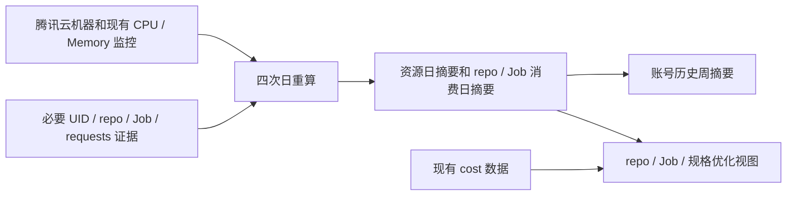

# 资源利用率采集设计：腾讯云 CICD

状态：Proposal；已完成部分只读验证，尚未实现或部署，没有修改云端配置。
验证日期：2026-11-23。业务口径更新：2026-11-24。
范围：仅腾讯云 CICD 账号 `100050658403`，不考虑组织其他账号。

配套文档：

- [真实 CI Pod 关联验证与成本估算](tencent-utilization-validation-and-cost-estimate.md)
- [数据保留、自动清理与防积压](resource-utilization-retention-design.md)

## 1. 已确认的目标与范围

本功能回答：

1. 账号买入的 CPU / memory 容量整体用了多少？
2. **哪个 repo、哪个稳定 CI Job / workload、哪种资源 / 规格**申请多、使用少，值得调整今后的资源模板？

### 明确不做

- **不按个人优化利用率**：不建个人 / owner / team 利用率视图、聚合键、排名或索引；不依赖 roster 或 author 解析。个人归属继续用于现有 cost 分账，该规则不变。
- **首版不做磁盘使用率**：不采集文件系统空间、PVC volume stats、磁盘 IOPS / busy 等利用率；不为补齐它们安装 Agent 或新建 Prometheus。此前额外提出的 CBS 闲置盘专题也先延后，避免扩大范围。既有磁盘成本账单不受影响。
- 不保存小时利用率事实或分钟原始点，不默认保存逐个已销毁 Pod 的使用流水。
- 不建长期时序库、多云插件平台，不自动缩容、关机或删除云资源。

利用率的主分析维度直接使用 **repo + 稳定 Job + 资源类型 / 规格**，不再将 cost 的 project/service 或个人归属作为必需维度。原有分账字段保留在原 cost 系统，不为本功能复制一套。

## 2. 保存粒度、保留与刷新

时间统一为 Asia/Shanghai；存储和比较时间使用 UTC。

| 数据 | 保存粒度 | 保存多久 | 刷新频率 |
| --- | --- | --- | --- |
| 云监控分钟 / 小时原始点 | 不持久化，只参与计算 | 计算结束释放 | 随汇总任务读取 |
| 资源日摘要 | 物理机器 / 节点 × 天，资源类型与规格为维度 | 当前周 + 上一周，最长约 14 天 | 每 6 小时 |
| Job 消费日摘要 | repo + 稳定 Job / workload + 资源类型 / 规格 × 天 | 同上 | 每 6 小时 |
| 必要关联 / 规格证据 | 日重算所需 UID、repo、Job、requests、节点关系和有效区间；不存完整 Pod 对象或个人资料 | 与对应日摘要同周过期 | 扩展已有 Pod LIST/WATCH 的白名单元数据出口（新工作，见 §3）；云机器清单约 30 分钟更新 |
| 历史账号周摘要 | 账号 + 计算资源类别 + CPU / memory 指标 × 周 | 长期 | 随日摘要更新；周结束后 7 天最终收口 |

日刷新时间：北京时间 **00:30、06:30、12:30、18:30**。
每轮重算当天和前一天后覆盖替换，不重复累加；失败日期仅在未过期且所需云指标仍处于已验证可读窗口、必要证据可用时有界补齐（见 §9）。当天标记“进行中”，固定本轮数据 cutoff，约留 10 分钟上报延迟，展示截止时间及覆盖率。

历史只有账号周趋势。明细过期后，不能追查旧 repo / Job 的日记录，也不能用新维度重新切旧明细；这是控制数据量的主动取舍。

## 3. 直接复用现有监控，不自建 Pod 采样

推荐数据源：**腾讯云资源清单 + 已有云监控 + 必要 Kubernetes / CI 元数据**，接入 Cost Insight jobs / TiDB。

| 对象 | 清单 / 容量证据 | 使用量来源 |
| --- | --- | --- |
| 普通 CVM | `DescribeRegions`、`DescribeInstances`，CPU / memory 规格、生命周期 | `GetMonitorData`，`QCE/CVM` |
| TKE 节点，包括 `np-*` 原生节点 | `DescribeClusters`、`DescribeClusterInstances`、必要 Node UID / providerID / capacity / allocatable | `DescribeStatisticData`，`QCE/TKE2` |
| TKE Pod 输入 | 复用现有 UID、namespace、repo / Job / build 关联；新增 nodeName、requests / limits 及其有效区间的白名单证据出口，不能从现有 lifecycle 表直接取得 | 同上，现有 Pod CPU cores、memory working set 和 requests 指标 |

不几秒一次访问 Pod，不装新监控 Agent。已有来源没有指标时明确显示缺口，不为第一版补建采样系统。
元数据入口只补齐本功能需要的 repo / Job / 规格证据；不增加 author / owner / roster 链路，也不采集 PVC / 云盘关联。

**新增元数据工作及责任边界**：由 `ci-dashboard` 既有 Pod watcher 接入侧扩展 namespace 范围的分页 LIST / WATCH 处理，提取 cluster、namespace、UID、Pod 名、nodeName、repo / 稳定 Job 证据和 Pod spec requests / limits；不读取或持久化使用量。Cost Insight 侧负责新 `cost_utilization_resource_observation` schema 与受门禁保护的批量 sink，把白名单字段按周保存为有界有效区间；不是扩展 `ci_l1_pod_lifecycle` 的保留期，也不能复用其个人字段。该出口是待实现的新工作，当前 watcher / lifecycle 尚未提供 node、requests / limits 时间线。

Pod 的 get/list/watch 复用既有 namespace RBAC。**Node 身份 / capacity / allocatable 也由 ci-dashboard 元数据接入侧负责**：在既有 Kubernetes 客户端旁新增 cluster-scoped `/api/v1/nodes` 分页 LIST（当前客户端只有 namespace collection 路径，不能直接调用当作已支持），约 30 分钟一次，经相同白名单 sink 输出并核对 TKE provider 身份。复用该接入侧已有 API-server URL、bearer token/provider、CA 配置；为其现有 Kubernetes 身份新增并审阅仅 `nodes get/list` 的 ClusterRole / binding，当前没有该权限。不增加 Node WATCH、Agent，也**不给 Cost Insight jobs 新增 Kubernetes 客户端、集群 bearer token 或 Node RBAC**。Cost Insight 只消费新证据 schema / sink；部署时另行验证 sink 对两张新表及 guard 的最小 DB 权限，不能假设 lifecycle 写权限已经覆盖它们。
首次 LIST / 重连只从观测时刻确认规格与节点关系，不能回填为整段历史；后续变化切断旧区间，丢事件 / 短命 Pod / 未证实的过去区间保持 unknown。requests 有效区间与使用量分钟桶相交后才进入分子 / 分母；不能把当前 requests 追溯整天，也不能用监控中的比率反推缺失 requests 冒充已验证证据。

### 已验证的事实与边界

- 逐 19 个可用地域发现 4 台普通 CVM；北京 TKE 清单查询时还有 52 个原生节点，不能只采普通 CVM。
- CVM CPU / memory、TKE 节点、Pod CPU cores / working set / requests 比例均已成功读取。
- 后续 20 分钟监控样本读到 498 个 `jenkins-*` CI Pod；277 个匹配现有 lifecycle，228 个已有 repo / build URL。已交叉核对真实 CI build 与 repo，证明链路可用，但不代表全量覆盖。
- 一周已记录 Pod 的 repo 字段约 53.46%、build URL 约 53.61% 有值，仍需测量 / 补齐 **repo / Job** 关联。原先 author 约 51% 的数据只是历史观察，不是本功能门槛。
- TKE 查询需 cluster 和 node / `un_instance_id` / workload 条件，不能只传 cluster；API 响应存在序列边界，要拆窗校验完整性。
- CVM `CpuUsage` / `MemUsage` 在 60 秒 metadata 为 avg，300 / 3600 秒可能为 max，不能拿峰值的平均冒充平均利用率。
- 此前磁盘读取尝试及权限结果仅保留在验证报告中，不再形成实施依赖或首版缺口任务。

## 4. 指标与计算口径

| 指标 | 分母 / 用途 |
| --- | --- |
| CPU 容量利用率 | 实际使用 cores / 同时刻已配置 vCPU，评估机器容量 |
| Memory 容量利用率 | 实际使用 bytes / 同口径总内存 bytes，缓存语义分别标识 |
| Job CPU requests 利用率 | 对应 Pod 实际使用 core-seconds / request-core-seconds，评估申请是否过多 |
| Job memory requests 利用率 | Pod working set 积分 / request-byte-seconds，评估申请是否过多 |
| CPU / memory 申请率 | 已调度 requests / 节点 allocatable，区分“买多”与“调度被过大申请占住” |

每项保存：日积分分子 / 分母、日均值、一分钟均值的日峰值及时间、覆盖率、截止时间；可用时保留 actual cores / bytes。
requests 为 0 / 未设置时效率为 NULL，相关使用量另列；不能压到其他 Pod 的 requests 上，也不能把超过 100% 的效率截断。

### 容量和时间加权

设 u 为实际使用量、c 为相同口径容量、Δt 为有效观测时长：

```text
日均值 = 100 × Σ_当日(u × Δt) / Σ_当日(c × Δt)
周均值 = 100 × Σ_各日(使用量积分) / Σ_各日(容量时间积分)
组日峰值 = max_当日t [100 × Σ_同一时刻u / Σ_同一时刻c]
同一 scope 周峰值 = max_各日(该 scope 日峰值)
```

CPU 的权重是核数 × 时间，memory 是同口径内存容量 × 时间。2 核 90% 与 32 核 10% 的同区间合计约 **14.71%**，不是 50%。
资源创建、删除、扩缩容、requests 变化按已知生效区间处理，不拿当前规格乘整天；没有变化证据时标记未知 / 估算。

日保存粒度不意味着只读一个日瞬时值。云端已有细粒度数据在有界内存计算中按时间对齐，生成日积分和同步峰值后释放。
不能相加资源在不同时间的峰值，也不能从多个 Job 日 max 还原任意筛选交集的同步峰值。只支持已预计算 scope / 组合的峰值，其他显示 N/A。
默认峰值是**一分钟平均值的最大值**，不是瞬时峰值。首版不做 P95、throttling、OOM 等诊断体系。

### 指标来源和单位

- CVM：`CPUUsage`；必要且经验证时可用 `BaseCpuUsage`，但记录 guest / hypervisor 来源；`MemUsage` 通常不含 buffer/cache。
- TKE 节点：`K8sNodeCpuUsage`、`K8sNodeMemUsage`；Pod：`K8sPodCpuCoreUsed`、`K8sPodMemWorkingSetBytes`。
- requests 比例：`K8sPodRateCpuCoreUsedRequest`、`K8sPodRateMemWorkingSetRequest`，用于交叉核对，不直接平均多个 Pod 百分比。
- 节点 requests / allocatable：`K8sNodeCpuCoreRequestTotal`、`K8sNodeMemoryRequestBytesTotal`、`K8sNodeNodeAllocatableCpuForCluster`、`K8sNodeNodeAllocatableMemoryForCluster`。
- 固定 `(namespace, metric, period, source_stat, unit, semantic_version)`。不能凭 `Bytes` 字段名猜单位，需核对 MBytes / MiBytes；不同缓存语义的 memory 不混算。
- 日宽行的每个指标字段组内联保存上述完整身份；requests 指标还保存分母来源 / 单位 / 语义契约，不能用一个未定义的行级版本替代。各 `(account, resource_class, 指标)` 的预期契约按周固定，变更从新周生效；日发布、日→周合并均逐指标核对契约。不匹配的日指标不混算、不转换成 0，计入预期范围的缺口并标记不完整；周行保存对应完整契约，防止把 60s avg、300s max 或不同 memory cache 语义合并。

## 5. 机器层与 Job 层不重复累计

- **账号 / 地域 / 机器类型总览只用去重后的机器监控**。普通 CVM + 原生节点属于物理层。
- 同一 CVM-backed TKE 节点同时出现在 CVM / TKE 清单时，按 provider / billing 身份去重，优先采用已验证的 TKE 节点事实，不能算两台。
- **repo / Job 的共享节点使用情况由 Pod 监控合并成消费日摘要**，不是账号总量的额外加项。
- 将来有独立计费弹性 Pod 时，明确其计费边界，排除虚拟节点重复计数，不直接套有底层机器的口径。
- 节点物理利用率的分母必须与来源一致；requests 申请率才使用 allocatable，不能拿物理百分比乘 allocatable 伪造实际量。
- 机器量与 Pod 合计的差额可能含系统、runtime、缺测和语义差异；不强行按 Job 分平，更不转成个人利用率。memory 缓存也不构成严格可加总恒等式。

## 6. repo、稳定 Job 与资源维度

Job 消费日组合为实际出现的：

```text
(usage_date, vendor, account, cluster, namespace,
 org/repo, stable_job/workload, resource_class, resource_spec)
```

- `repo` 使用明确的 org/repo 证据；优先已有 CI build / Pod refs 关联，不从机器 owner 猜 repo。
- `stable_job` 使用去掉 build 编号的规范化任务路径；不含 Pod 名、build ID、PR 编号或随机 Jenkins label。否则只是把一次性 Pod 记录换了名字。
- `resource_class` 区分普通 VM / TKE 等计算模式；物理规格保留核数 / 内存 / 可得机型，消费规格保留 CPU / memory requests 组合；节点池 / 机型只在证据可得时作为已声明维度，不猜测。
- 缺 repo 或 Job 时放入 `unknown_repo` / `unknown_job`，实际使用量仍保留在对应 scope 和覆盖率中，不能丢弃或分摊给已知 Job。
- **author / owner 缺失不得影响以上任何匹配**。新日表、辅助表、rollup 不复制个人邮箱 / employee ID / roster，不产生个人维度。
- 辅助身份键用 cluster + namespace + UID；监控只有 Pod 名时必须校验有效时间，名称重用和节点迁移不能串数据。
- 元数据有效区间仅用于按天重算；重连 LIST 不能把今天标签追溯到对象创建时刻。闭环证据过期随日摘要删除。

只保存实际出现的组合，不展开维度笛卡尔积。固定 rollup 为 **`account_class`（vendor + account_id + resource_class）**、repo、Job、资源类型 / 规格；叶子组合与 rollup 用不同 scope，查询不能混加。`account_class` 按去重物理机器层跨地域 / 集群实时对齐汇总，逐类保存日积分与同步日峰值，是账号周表唯一输入，不从 repo / Job 消费层或各机器的独立峰值相加生成。全账号日总览如需跨类别合并，必须另行预计算其同步峰值，不能把各类别峰值相加。
筛选只支持已保存的业务维度，不承诺任意原始 label 事后重切。新增维度自启用日起生效。

## 7. 数据质量与现有实现复用

监控缺失不是 0%，无权限不是空账号；不长时间 forward fill。
每项区分监控覆盖、repo / Job 归属覆盖、清单范围；归属覆盖按实际量 / requests / 容量时间等明确口径测量，不能拿有字段的 Pod 数替代所有利用率指标的覆盖率。
日 / 周平均值只使用分子和分母同时有效的区间，低于建议 95% 阈值标记不完整。
完整组峰值仅让已发现应监控容量覆盖 100% 的分钟桶参与，保存峰值时刻分母 / coverage；其他单列 observed-subset peak，不能冒充完整峰值。

`ci-dashboard` 现有 lifecycle、Pod 元数据及 build URL 关联可以复用，但较新快照会覆盖旧标签，尚非完整规格 / 生命周期账；其 schema 没有 nodeName、requests / limits。按 §3 新增 ci-dashboard 侧的 watcher 元数据出口、cluster-scoped Node LIST 与该侧最小 RBAC，复用其已有集群凭据；Cost Insight 侧新增证据 schema / sink 及最小 DB 权限，只补 UID、repo / Job、requests、节点及时间证据，不平行建设一个全面 Pod watcher，也不借机补个人归属。
现有 watcher 的实际部署与全量 repo / Job 覆盖仍需核对，不将代码存在当作已全量上线。

## 8. 与 cost 的边界

个人归属继续用于现有成本分账，本功能不改 importer 或分摊算法。
腾讯非 supernode cost 当前有 build-weighted 分摊；**该个人分账不能当作 Job 实测利用率或精确 Job 成本**。
账号 / 资源层可对比可比日期的 cost 与机器利用率；repo / Job 成本只有存在已验证的同维度证据时才显示，否则明确不可比，不把个人分账硬投影回来。

- 先将资源 cost 聚合为唯一资源 / usage_date 金额，再与利用率匹配，避免一个资源的多个分账参与者行放大用量。
- 从 serving 读取时只取 publication 的 active materialization version。
- 账单 RegionName / ResourceId 或名称回退，与监控 region code / providerID 需要明确身份桥接，歧义保持 unmatched。
- 当前腾讯 importer 校验 OwnerUin 等于配置 account_id，保持本账号校验，不做组织账号发现。
- utilization 每六小时更新，cost 有 D+3 / D+5 延迟；展示各自截止时间，只比较重叠的实际使用日期，不把 BillDay 入账日期当使用日期。
- 本视图按北京时间周一开始；原 CI / QA cost 周报按周日 UTC。overlay 必须重聚合相同日期范围，不能直接复用旧周名或预算桶。
- 原磁盘 / 网络 / COS 等成本继续显示在 cost 系统，但不得混进 CPU / memory 利用率分母。

`1 - utilization` 不等于可回收费用，不能用 `cost × (1-utilization)` 宣称可节省金额。

## 9. 存储、刷新与一致性



| 数据集 | 内容与生命周期 |
| --- | --- |
| `cost_utilization_resource_observation` | 日重算所必需的身份 / 规格 / 关系有效区间，按周切片；不复制个人资料，不采集磁盘 / PVC 关系 |
| `cost_utilization_daily` | 日期 + scope + 资源 / 稳定 repo-Job-资源组合，含 `account_class`（vendor + account_id + resource_class）固定日 rollup；CPU / memory / requests 宽行，各指标保存完整来源身份 / 分母契约（§4）、积分、avg、日 peak、coverage、cutoff、partial / stale |
| `cost_utilization_weekly` | 账号 + 计算资源类别 + 指标 × 周；只合并同类 `account_class` 日行；积分、峰值、覆盖率、完整指标契约和最终状态；不带 repo / Job / 个人 / Pod |

两张短期表从创建起就带不可续期 `expires_at NOT NULL`、`week_start` 和 `(expires_at, id)` 索引。旧小时表从未实现，不新增它。
日组合基数需按去个人、去磁盘的新维度测量；旧 120 万 / 55 万行和含磁盘的日参照都不是当前承诺。暂预留 1–2 GiB，实际行数、索引和费用在 canary 校准。

### 每轮日刷新

1. 固定 DB / UTC cutoff，从云端现有细粒度监控读取当天和前一天；包含已经退出但在该日出现的节点 / Pod，不只查询当前存活对象。
2. 按 API 时间、对象、点数与序列上限拆窗；返回端点按对象 + metric + timestamp 去重，采用左闭右开边界。分钟数据只在有界计算中使用。
3. 生成完整资源 / repo-Job-资源组合及固定 rollup 的日结果。只有某 scope 得到完整处理，才声称成功；API 失败不以空结果覆盖旧数据。
4. 按日期原子替换：删除旧组合、写入新结果和 checkpoint；必须删除已消失的 group，不能只 upsert 留脏行。失败整体回滚、保留上一版并标 stale。
5. 日事务大小 / 耗时先在 canary 验证；超预算就停止该日发布并评审，不能临时引入无人清理的 staging / 历史版本。
6. 失败日期只在“未过期保留窗 ∩ 所需细粒度云指标的已验证可读窗 ∩ 必要证据可用窗”内有界补齐；不累计重复日值，不延长过期时间。每次成功日发布都刷新**该日期所属周**（含当前周、上一周和合法重试影响的周），仅合并 `(vendor, account_id, resource_class)` 的 `account_class` 日 scope，逐指标校验 §4 契约，不再累加资源 / 消费 scope。

对成功日期不额外建立迟到归属重切任务：日期 d 的最后一次常规全日重算为 d+1 的 18:30 轮，之后新到的 repo / Job 证据不会自动改善该日 unknown 比例。日行记录关联证据截止时间 / coverage；两周保留仅为补采、核对和清理宽限，不承诺持续重新归因。若确需更正，只能显式走未过期且云点 / 证据仍可用的有界人工 repair，并重新发布受影响周；不能从未保存的 Pod 使用事实推算，也不续期。

周结束 E+48h 的阶段性 coverage 结果由**独立 15 分钟维护任务**按持久化采集契约 / 日历触发，并记录 `quality_checkpoint_at`；即使该周没有新的日发布也会执行，失败在后续轮重试。它不是最终冻结：D 前合法日重试仍刷新所属周；D 时维护任务最终收口。

**云端可重算窗口不是明细保留承诺**：现有只读证据仅证明 2026-11-23 的 20 分钟 60s Pod 点和约一周 3600s 历史统计可读；尚未验证任何来源的 60s avg 可读寿命，不能由此承诺 14 天分钟重放。P0 必须逐 namespace / metric / period / source_stat 核实可读 horizon、上报延迟和安全余量，记录在固定采集契约；至少覆盖正常当天 / 前一天全日重算及重试余量，否则阻止该指标正式上线，不降级用 max 冒充 avg。

每次重试前以 DB 当前时间和契约 horizon / 安全余量检查整个目标区间是否仍可读；未知 horizon 不启用扩展日期补采。已越界、证据不足或接口返回不完整时，不以裁剪后的半天 / 粗粒度结果覆盖完整日：保留最后可信日版本并标 stale、记录截止时间 / 缺口；没有可信版本则保持 missing。已缺失且不可重读的分钟峰值不推算。周收口仍只使用已保存且契约相容的日积分 / 峰值和真实 coverage，缺失 / stale 范围影响最终完整性，D 到期照常 fence / 收口 / 清理，不再依赖云端重读。

## 10. 到期清理和防残留

周界：周一 00:00，北京时间。使用周 W 的明细固定在 W + 14 天过期，即周结束后 7 天。
每周结束 48h 产生覆盖率结果，7 天宽限结束最终收口；长时间失败发布 `final_incomplete` / `final_missing`，不为汇总、repo / Job 解析或账单延期永久扣住明细。
先 fence 再读账号日摘要，并原子提交最终结果 / 关闭水位；整周无行也依据持久化采集契约生成缺失状态。

独立清理每 15 分钟运行：每事务最多 1000 行，每轮 5 万行或 5 分钟；最老过期周先删日行，再删同周辅助证据，覆盖停采账号和冷数据。
容量指标统一为**两张短期表合计的保留行数，以及两表数据 + 索引的观测字节数**，不是仅 observation 表或仅索引。合计保留行数达 100 万或数据 + 索引字节达 4 GiB 预警，达 200 万行或 8 GiB 任一门限就暂停新增；过期积压或维护心跳失联超过 4h 同样停写，维护仍运行。字节阈值受统计 / GC 延迟影响，不是物理磁盘硬配额。
不把删除数据搬到 COS / GCS，不新增永久 quarantine、候选 manifest 或完整原始响应日志。
DB 故障不能保证按时物理回收，但必须 fail closed 防止继续写入。具体事务、门禁、恢复和验收以[生命周期设计](resource-utilization-retention-design.md)为准。

## 11. 首版页面与优化候选

- **账号总览**：CPU / memory 日 / 周均值、峰值、容量规模与 coverage；不显示“磁盘使用率待补”卡片或个人利用率卡片。
- **优化主表**：按 repo → 稳定 Job → 资源类型 / 规格查看实际量、requests、效率、峰值、有效时长、覆盖率，当前日标 partial。
- **候选**：requests 高而实际低；CPU 低但 memory 高或相反的规格错配；机器容量富余而申请率偏高。只给候选，不自动动作。
- **缺口**：unknown_repo / unknown_job 单独展示，不丢用量，不伪装为完整 Job 排名。原先个人字段不足不影响此页面。

## 12. 实施前验证与上线门槛

### P0：验证所需链路，不再扩展不做的指标

- 核对账号机器范围、TKE 机器身份去重、CPU / memory 单位与缓存语义、requests 分母。
- 核对既有 watcher 的 LIST/WATCH 与 lifecycle schema，验证 §3 ci-dashboard 新白名单元数据出口及 cluster-scoped Node LIST 的字段、requests 语义 / 有效区间、现有 URL / token / CA 配置和该侧 Node 只读 RBAC，核对 Cost Insight sink schema / 最小 DB 权限；明确这是新增 schema / 接入工作，不是现成字段复用。重点测量 repo / stable Job / UID / requests / 节点关系覆盖，验证重连、丢事件、短命 / 子 Pod 场景；不补 author / owner，不追磁盘空间指标。
- 对每个 CPU / memory / requests 来源验证 60s avg 的可查询 horizon、延迟与安全余量（包含当天 / 前一天及候选重试日期）；记录已验证范围，按 §9 限制补采。3600s 统计不能证明分钟保留期；测试越界保留 stale / missing、只用已存日行收口的降级路径。
- 测量去个人后的稳定组合日基数；job key 不含 build / Pod 随机值，资源规格能支持模板优化。
- 核对已有元数据入口、DB 套餐，先以有界 canary 验证四次整日重算成本，再确定正式预算。暂以 ¥100/月作为校准起点，不当作已测总价。

### P1：计算资源日级 MVP

同时交付 §3 所述 ci-dashboard watcher 元数据出口、cluster-scoped Node LIST 及其只读 RBAC，Cost Insight 证据 schema / sink 及最小 DB 权限，以及 CVM / TKE CPU / memory、repo-Job-资源消费日摘要、`account_class` 日 rollup / 周趋势、受已验证源窗口限制的补采和独立清理、索引、guard、告警、writer 门禁。未通过清理演练不得正式采集。
**只有账号机器总量、没有 repo / Job 实际申请与使用视图，不算需求完成；没有个人维度、没有磁盘指标则不构成缺陷。**

### 验收

- 异构规格 / 时间加权，扩缩容与销毁，机器 / Pod 不双计，requests 为 0、缺点不补零。
- repo / Job 匹配不依赖 author；Pod 名重用、未知归属不丢用量，稳定 Job 去除 build 编号，资源规格正确分组。
- 日分窗端点去重、重复重算不翻倍、消失组合清除、原子发布失败回退；同步 group peak 不用各资源峰值的和代替。验证混入不同 period / source_stat / 单位 / 缓存语义的日指标被拒绝合并并显式缺口，按资源类别仅从 `account_class` 日行生成周结果。
- 模拟 60s 点短于 14 天可读期：越界日期不重放 / 不用 3600s max 降级，保留最后可信日版本及 stale / missing 状态，周收口不查已销毁资源或重新扫描叶子事实。
- 同日期 cost 不放大，不更改个人分账；缺少 Job cost 证据不伪造。
- 隔离库模拟 6 周、实际周切换、到期明细清零且周趋势保留、失败 / 停采 / 并发旧 writer / 4h 停写与恢复；没有永久副本。验证 100 万行 / 4 GiB 与 200 万行 / 8 GiB 均按两表数据 + 索引合计生效，不能只测 observation 索引。
- 维护任务独立触发 E+48h checkpoint；即使没有新日发布也生成 coverage 结果，D 前晚重试更新所属周。验证成功日期在次日 18:30 后的迟到归属不自动重切、证据截止时间可见；显式 repair 仍受 source horizon / 截止 fence 限制。
- 当前 scope 不包含磁盘利用率、个人索引 / rollup 或个人覆盖率门槛。

## 13. 需要重点关注的已定取舍

- 业务主线已经明确为 **repo + Job + 资源**，个人只属于分账；此前关于个人覆盖门槛、project 是否等于 repo、磁盘首版是否必须支持的待确认项关闭。
- 日摘要的 peak 是分钟均值峰值；没有分钟 / 小时持久化曲线，任意组合峰值不能事后拼出来。
- 两周后只剩账号周趋势，不能追旧 repo / Job 日明细或用新增 label 重切过去数据。
- 明细到期不无限延期；长期失败时允许历史趋势有可见缺口，而不是留下大量无用历史数据。
- 正常已成功日期只重算到次日 18:30；之后迟到的 repo / Job 证据不会自动改善该日 unknown。两周保留不等于持续重切归属，界面展示证据截止时间；确需更正仅可在来源与保留窗内做有界 repair。
- 剩余工作是技术验证：repo / Job 证据、日组合基数、重算事务和实际成本，不需要再让用户为个人字段或磁盘指标作选择。

## 14. 实施入口与参考

- [腾讯云账单导入](tencent-billing-import-design.md)
- [腾讯云 CI 共享成本](tencent-ci-native-shared-cost-allocation-design.md)
- [资源 serving](resource-serving-materialization-design.md)
- `src/cost_insight/jobs/{cli,state_store,allocate_tencent_ci_cost}.py`
- `../../ci-dashboard/src/ci_dashboard/jobs/{pod_watcher,pod_source,sync_pods,build_url_matcher}.py`
- [GetMonitorData](https://cloud.tencent.com/document/product/248/31014)
- [DescribeStatisticData](https://cloud.tencent.com/document/product/248/51845)
- [TKE Pod 指标与维度](https://cloud.tencent.com/document/product/248/53821)
- [监控 API 计费](https://cloud.tencent.com/document/product/248/77914)
